

  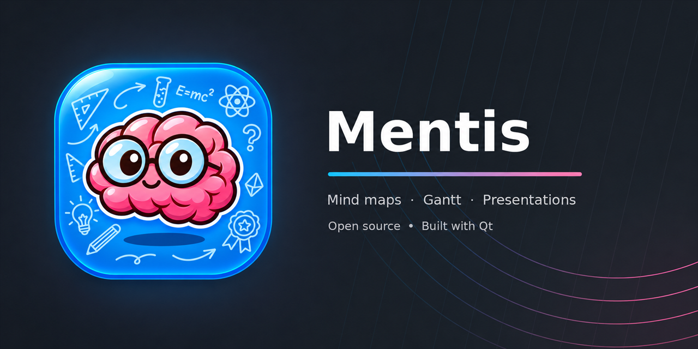

  
  
  
  

  <b>Free and open-source study app: mind maps, Gantt plans, notes and presentations in one place.</b>

  <a href="#-what-you-can-do">Features</a> ·
  <a href="#-download-and-build">Download</a> ·
  <a href="manual/README.md">Manual</a> ·
  <a href="#-contributing">Contributing</a> ·
  <a href="#-goals-and-support">Support</a> ·
  <a href="https://ko-fi.com/simozock">Ko-fi</a> ·
  <a href="https://liberapay.com/simozock">Liberapay</a>

---

**Mentis** is a free and open-source desktop application for students: mind maps, Gantt plans,
notes and presentations in one place, with images, attachments, links and SVG stickers, so that
everyone can study efficiently and effectively — whatever computer they have.

Mentis is developed in Switzerland and in Europe, and it respects European privacy rules: it
follows the GDPR and the Swiss Federal Act on Data Protection (FADP / LPD).

  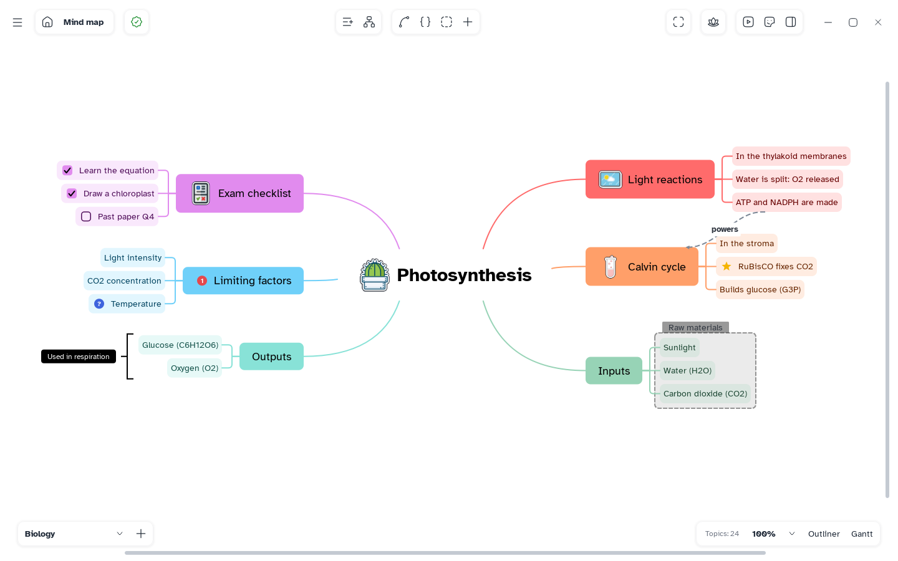

<table>
  <tr>
    <td align="center" width="25%"><b>🧠 Mind maps</b> Many structures, styles and an infinite canvas</td>
    <td align="center" width="25%"><b>📝 Notes</b> Outliner, tasks, images, formulas and attachments</td>
    <td align="center" width="25%"><b>📅 Gantt</b> Every sheet as a plan with dependencies and costs</td>
    <td align="center" width="25%"><b>🎞️ Pitch</b> Turn a map into slides with themes</td>
  </tr>
</table>

## 💡 The name, the icon and the mascot

<table>
  <tr>
    <td align="center" width="160">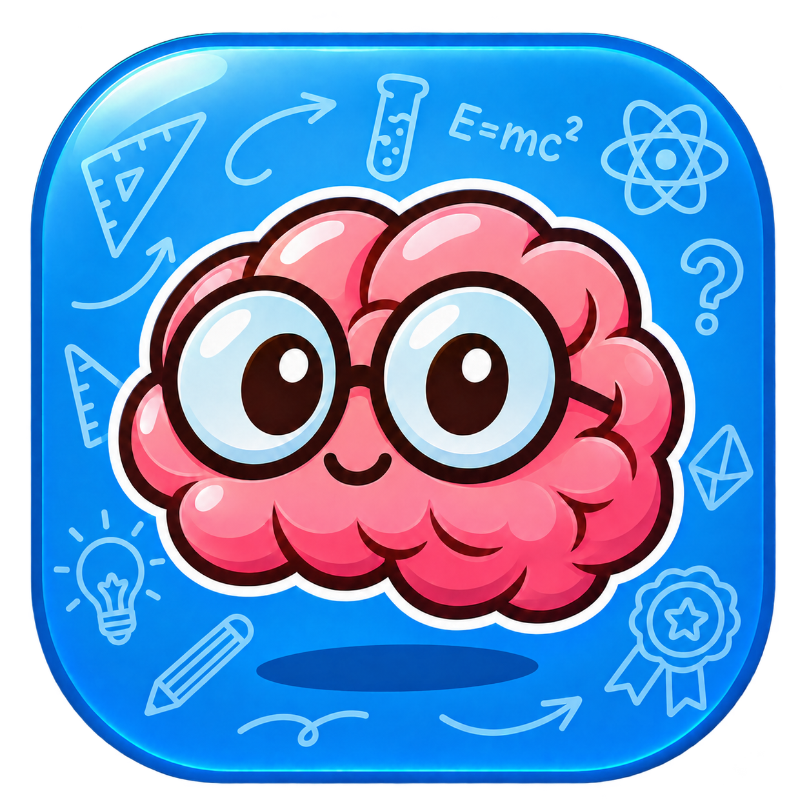</td>
    <td>
      <i>Mentis</i> is Latin for "of the mind". The icon shows exactly that: a curious brain with
      glasses, floating on a study tile drawn with the doodles of a school notebook — formulas,
      rulers, ideas and arrows.
    </td>
  </tr>
  <tr>
    <td align="center" width="160"></td>
    <td>
      The same brain is our mascot, here ready for a long journey. Every great journey starts with a
      small step, and so does every map: one idea, then the connections that matter and the few key
      words that make it truly meaningful to its creator. In the app, the mascot guides the first
      tour, and its expressions are also a sticker collection you can put on your maps.
    </td>
  </tr>
</table>

## ✨ What you can do

  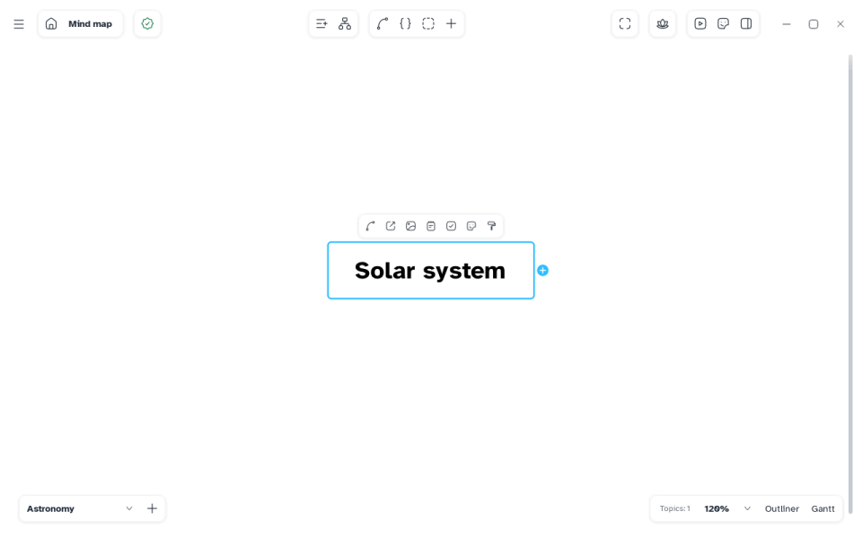

### 🧠 Mind maps

- An infinite canvas with zoom, pan, multiple selection and an automatically balanced layout.
- Many map structures: mind map, logic chart, org chart, tree, tree table, brace map, timeline,
  fishbone and more, each with ready-made style variants.
- Topic styles: shapes, colours, colour palettes by level, branch styles, numbering, fonts, and
  copy/paste of a style.
- Relationships between topics, boundaries, summaries and floating topics.
- Several sheets in one document; move a branch to a new sheet.

  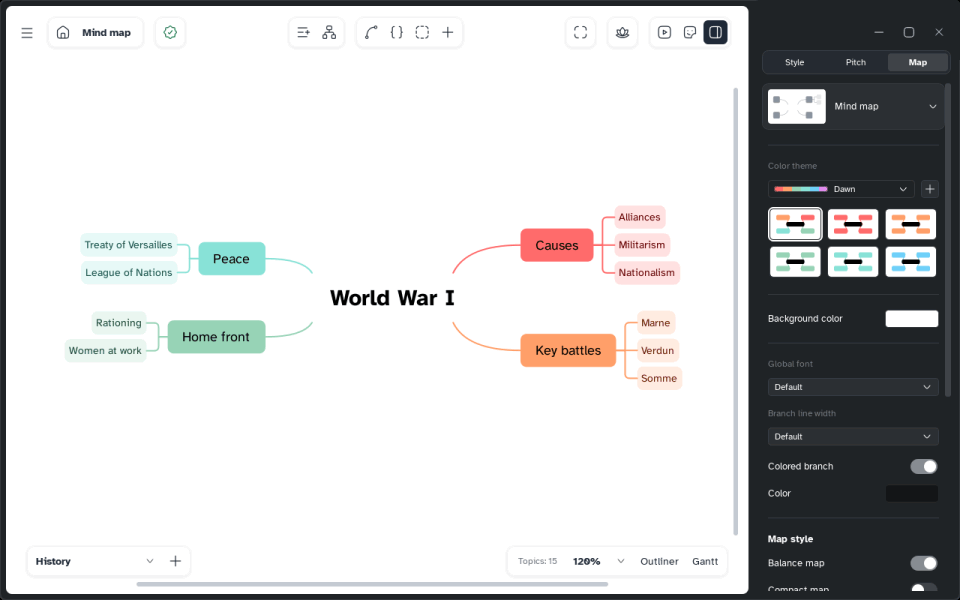

### 📝 Notes and contents

- An outliner to write the map as an indented list, with Markdown shortcuts while typing.
- Notes, labels, tasks with a checkbox, dates, priority and people.
- Images, audio, LaTeX formulas, links to web pages and to other topics, and local files attached
  to a topic, all stored inside the document.
- SVG stickers and markers, with a built-in sticker editor.
- Advanced search, spell checking (Windows) and a focus mode without distractions.

  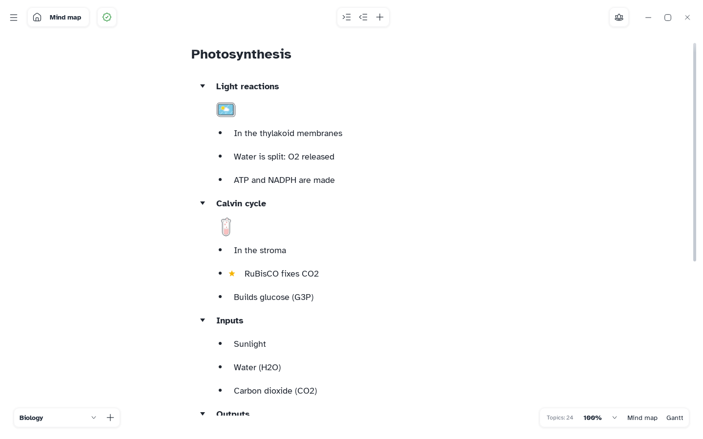
  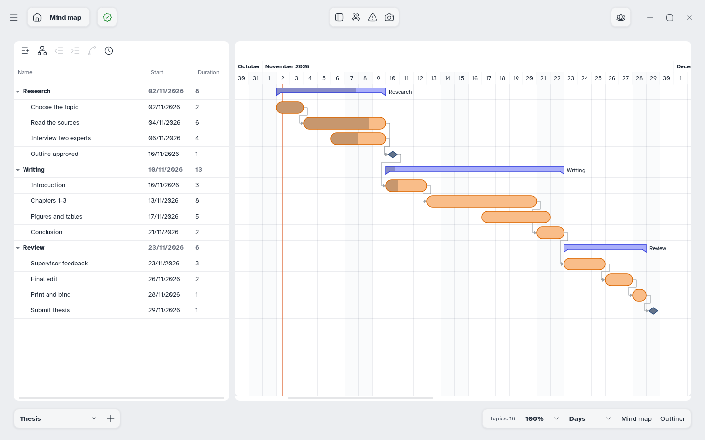

### 📅 Gantt plans

- Every sheet can be shown as a Gantt plan: tasks, dependencies with type and lag, milestones,
  resources and working week, costs, baselines to compare, and export.

### 🎞️ Presentations

- **Pitch** turns a map into slides, with themes and your own templates to share.

  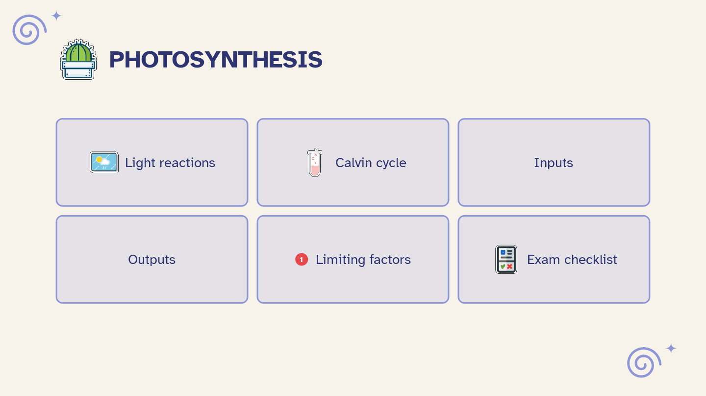
  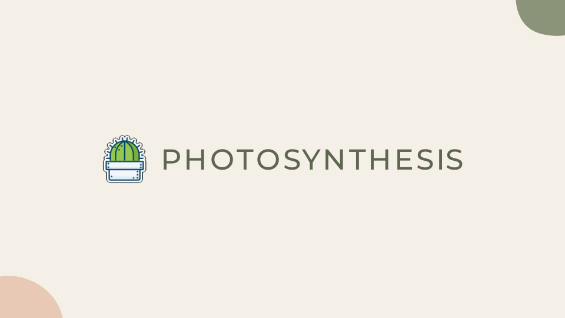

### 💾 Files

- The native `.mentis` file is a single SQLite database: transactional saving, automatic save,
  undo/redo history and recovery points, images and attachments embedded and de-duplicated.
- Import Markdown; export to Markdown, PNG, SVG, PDF, print, Word and Excel.

### 🌍 For everyone

- Readable fonts included: Atkinson Hyperlegible and OpenDyslexic.
- Light and dark interface, adjustable text size and density, editable keyboard shortcuts.
- Interface in English and Italian.
- Performance profiles that keep it fast on old and low-power PCs.

  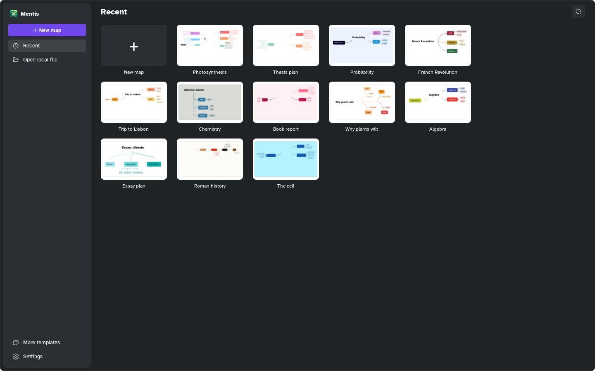
  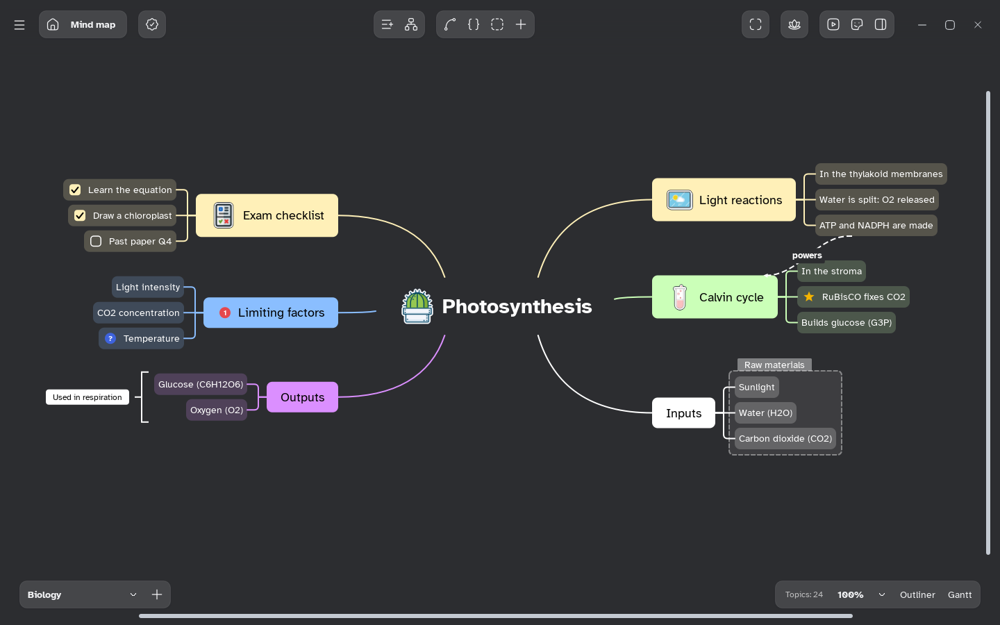

## 🤖 An MCP server for AI agents

Mentis is also an [MCP](https://modelcontextprotocol.io) server: `Mentis --mcp` lets an AI agent
(Claude, Codex and other MCP clients) read and build your maps — create maps and sheets, add and
move topics, set styles, import and export Markdown — once you turn it on in Settings: then the
agent can work on any map on your computer, and on the maps open in the app.

## 📦 Download and build

Ready-to-install releases will be published on the
[Releases](https://github.com/simozock/Mentis/releases) page. Until then, you can build Mentis from
source: see **[BUILD.md](BUILD.md)**.

> [!NOTE]
> **Privacy.** Mentis connects to the internet only to check for updates: once a day, at startup,
> it asks GitHub (`github.com`) for the latest release, and it downloads an installer only when
> you choose to update. The check can be turned off in Settings > General > Updates. Mentis sends no
> other information to any networked system unless you ask it to (for example by opening a link).

### Code signing policy

Free code signing provided by [SignPath.io](https://about.signpath.io), certificate by
[SignPath Foundation](https://signpath.org). The application to the program is in progress: until
it is accepted, Windows releases are not signed and Windows may warn before running the installer.

- Only the project's own files are signed (`Mentis.exe`, `MentisMathText.dll` and the installer),
  built from this repository by GitHub Actions; third-party libraries are not.
- Committers and reviewers: [simozock](https://github.com/simozock). Every change from someone else
  is reviewed by a team member before it is merged.
- Approvers: [simozock](https://github.com/simozock). Every signing request is approved by hand.

## 📚 Documentation

| | |
|---|---|
| 📖 **[User manual](manual/README.md)** | One short page per feature, with pictures from the app |
| 🛠️ **[Build from source](BUILD.md)** | Requirements and steps for Windows, macOS and Linux |
| 🗒️ **[Changelog](CHANGELOG.md)** | What changed in every version |
| 🗺️ **[Roadmap](ROADMAP.md)** | The next planned steps |
| 🌐 **[Translations](translations/README.md)** | How to translate the interface into your language |

## 🌐 Languages

The interface is available in English and Italian. Anyone can translate it into another language
by editing one plain text file, also in the browser: see [translations/README.md](translations/README.md).

## 🚦 Project status and roadmap

Mentis is the developer's first open-source project, so there may be bugs. Please report them in
the [Issues](https://github.com/simozock/Mentis/issues/new/choose): reported bugs will be fixed in
the coming period. Security problems are reported privately: see [SECURITY.md](SECURITY.md).

The next planned steps are in **[ROADMAP.md](ROADMAP.md)**. The roadmap will be
**community-driven**: the most requested features will be added to it and developed according to
the requests and the time of the developers. Propose an idea with a
[feature request](https://github.com/simozock/Mentis/issues/new/choose) or in
[Discussions](https://github.com/simozock/Mentis/discussions).

## 🤝 Contributing

Every help is welcome: bug reports, ideas, [translations](translations/README.md), documentation
and code. Start from **[CONTRIBUTING.md](CONTRIBUTING.md)** and please follow the
[Code of Conduct](CODE_OF_CONDUCT.md).

## 🎯 Goals and support

Mentis is free and will stay free. Before building the other programs of the study suite (mind
maps, notes, a second brain and more), the next goals are:

1. **Signed releases for Windows and macOS.** Code signing lets the system trust the installer
   without warnings. For Windows we are starting the application to
   [SignPath](https://signpath.org) (see [Code signing policy](#code-signing-policy)). For macOS we
   will wait until we have raised the funds for an Apple developer account.
2. **European, privacy-oriented hosting and our own domain.** Once the releases are signed, we will
   move to hosting on European servers focused on privacy, such as
   [Infomaniak](https://www.infomaniak.com), with a domain from which all the versions of the whole
   study suite will be released — privacy-oriented and compliant with the GDPR and the Swiss FADP
   (LPD).

If Mentis helps you study, you can help reach these goals with a donation:

  
  

Starring the repository, reporting bugs and telling other students about Mentis help just as much.

## ⚙️ Why C++ and Qt

Mentis is the first piece of a planned **suite of study programs**. C++ and Qt were chosen for
their strong performance, as an experiment, and for their wide compatibility with older operating
systems, so that every student can use it regardless of their hardware. A rewrite in **Rust**, with
another graphical interface system, is being evaluated, so that the rest of the suite can share the
same language and ecosystem.

## 🧪 How it was made

- **AI was used** to build this project, and we say so openly.
- **No reverse engineering.** Mentis was written in a clean room: by observing how other programs
  behave and trying to make a tool that takes the best of their features, without using their code,
  files or assets.

## 📄 License

Mentis was born open source and wants to stay that way: the code is free and available to everyone.
Before using it, please read the license: **[GNU AGPL-3.0](LICENSE)**.

Third-party components keep their own licenses (each in its folder):
[Qt](https://www.qt.io/licensing) (LGPL-3.0),
[JKQTMathText](third_party/jkqtmathtext) (LGPL-2.1), the fonts Atkinson Hyperlegible,
OpenDyslexic, Roboto, Montserrat and Arvo (SIL OFL 1.1), the icons
[Lucide](assets/icons/LICENSE-lucide.txt) (ISC) and [Hugeicons](assets/hugeicons/LICENSE-hugeicons.md)
(MIT), and the stickers from [SVG Repo](https://www.svgrepo.com) (CC0).

## ⭐ Star history

<a href="https://www.star-history.com/#simozock/Mentis&Date">
  <picture>
    <source media="(prefers-color-scheme: dark)" srcset="https://api.star-history.com/svg?repos=simozock/Mentis&type=Date&theme=dark" />
    <source media="(prefers-color-scheme: light)" srcset="https://api.star-history.com/svg?repos=simozock/Mentis&type=Date" />
    
  </picture>
</a>

   
  Made with care in Switzerland · Free and open source

