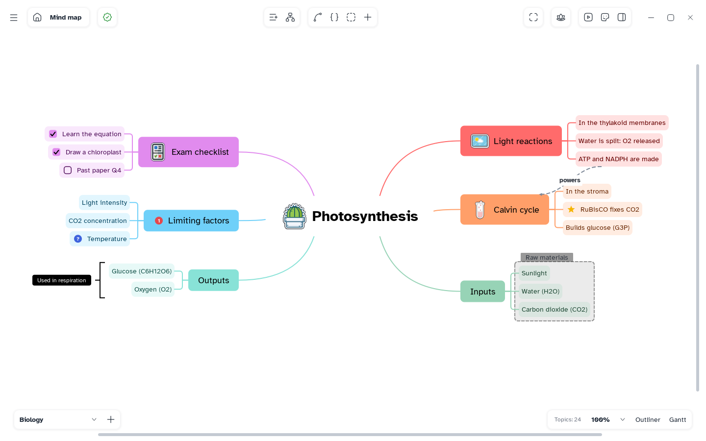

# Mentis user manual

Mentis is a free app for studying with mind maps, outlines, Gantt plans and presentations. One
short page per feature.

## Start here

- **[Install Mentis](getting-started/install.md)** — Windows, Linux, macOS and updates
- **[Your first map](getting-started/first-map.md)** — <kbd>Tab</kbd>, <kbd>Enter</kbd>, save
- **[The window](getting-started/window.md)** — what every part does

## Areas

1. **[Getting started](getting-started/README.md)** — install, the Home, your first map, the window
2. **[Map](map/README.md)** — topics, arrange, map types, sheets, relationships, boundaries, summaries, numbering, search, zoom, focus mode
3. **[Topic contents](topic-contents/README.md)** — notes, labels, checkboxes, images, formulas, links, files, markers, stickers
4. **[Style](style/README.md)** — topic style, text, branch lines, color themes, map style, copy and reset
5. **[Outliner](outliner/README.md)** — the outliner, Markdown shortcuts, paste and import
6. **[Gantt](gantt/README.md)** — the view, tasks, dependencies, people and costs, baselines, style, export
7. **[Pitch](pitch/README.md)** — slides, presenting, themes and templates, export
8. **[Files](files/README.md)** — save and open, undo, export as image, PDF and documents
9. **[Settings](settings/README.md)** — general, appearance, editor, keyboard shortcuts, spell check
10. **[AI and MCP](ai-agents/README.md)** — what agents can do, set-up, working with an agent
11. **[Questions](questions/README.md)** — short answers to common questions

## Writing the manual

Pages follow [TEMPLATE.md](TEMPLATE.md) and [STYLE.md](STYLE.md); pictures are generated by the app
([tools/media](../tools/media/README.md)).
