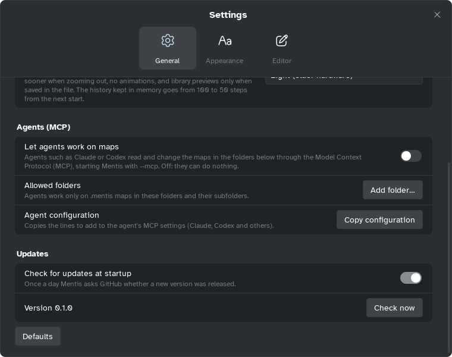

[Manual](../README.md) › [AI and MCP](README.md) › Set up an agent

# Set up an agent

Connect an AI agent to Mentis: one switch, then restart the agent's app.



## Turn it on in Mentis

1. Open **Settings** › **General** › **Agents (MCP)** and switch on **Let agents work on maps**.
2. Mentis adds itself to **Claude Desktop**, **Claude Code** and **Codex** if they are on this
   computer; **Agent apps** says which. Restart them.

If Mentis moved, or you installed an agent's app later, click **Add again**.

## Connect another app by hand

If no app is found, or one cannot be changed, Mentis copies the configuration by itself and asks
you to paste it. For any other MCP app, click **Copy configuration**. It copies the lines the agent
needs, with this computer's path of Mentis:

   ```json
   {
     "mcpServers": {
       "mentis": {
         "command": "C:\Users\you\AppData\Local\Programs\Mentis\bin\Mentis.exe",
         "args": ["--mcp"]
       }
     }
   }
   ```

Paste them where the app keeps MCP servers (its documentation may change):

| App | Where |
|---|---|
| **Claude Desktop** | Settings › Developer › Edit Config: put the `"mentis"` part inside `"mcpServers"` of `claude_desktop_config.json`, restart. [Guide](https://modelcontextprotocol.io/quickstart/user) |
| **Claude Code** | `claude mcp add mentis -- "<path of Mentis>" --mcp`. [Guide](https://docs.anthropic.com/en/docs/claude-code/mcp) |
| **Codex** | In `~/.codex/config.toml`: `[mcp_servers.mentis]` with `command = "<path of Mentis>"`, `args = ["--mcp"]`. [Guide](https://github.com/openai/codex/blob/main/docs/config.md) |
| Other MCP apps | Usually the same `command` and `args`. |

To check, ask "list my recent Mentis maps".

> [!TIP]
> Switch off **Let agents work on maps** to stop all agents at once.
