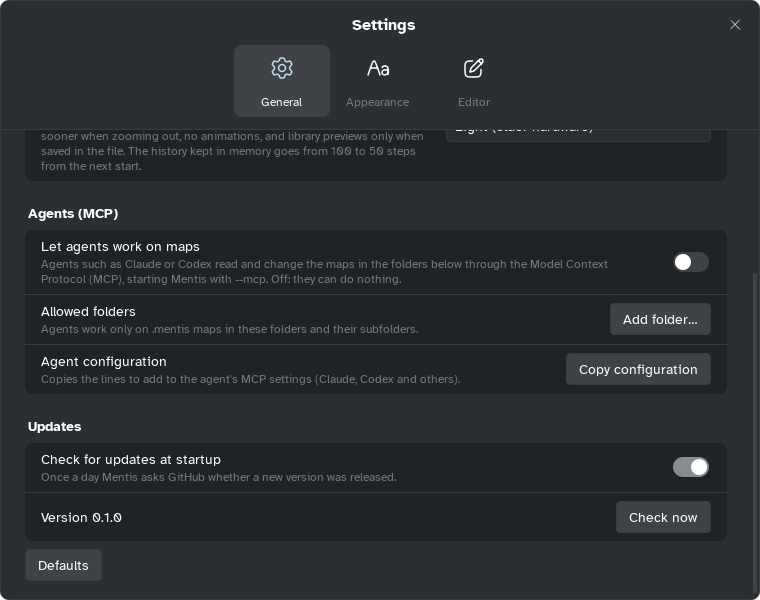

[Manual](../README.md) › [AI and MCP](README.md) › What agents can do

# What agents can do

An agent uses your commands, within your rules.

## See what an agent can change

| Area | For example |
|---|---|
| **Maps and sheets** | Create, read, open in Mentis (after your yes); add, rename, copy, move sheets; map type |
| **Topics** | Add, change, move, delete; notes, labels; Markdown import, export |
| **Style and contents** | Shapes, colours, themes, markers, stickers, pictures, formulas, links, checkboxes, files |
| **Map elements** | Relationships, summaries, boundaries, floating topics |
| **Gantt** | Dates, durations, dependencies, people, costs, working week, baselines, style |
| **Pitch** | Theme, aspect ratio, slides, Pitch templates |
| **Library** | Sticker and marker collections, colour palettes |
| **Export** | PNG, SVG, PDF, Word, Excel, Markdown |
| **Mentis windows** | Open a window for you, such as Export PDF or a note |

## Know the rules

- **Off until you turn it on** (see [Set up an agent](set-up.md)).
- **Any folder you name**, only `.mentis` maps, plus **the map open** in Mentis. Exports and added
  files go where you say.
- **No deleting files, no running programs.**
- **Your yes first** to replace a file, delete a sheet, palette, Pitch template, collection or
  sticker of yours, or remove a person with tasks ([how](work-with-an-agent.md#answer-its-questions)).
- **Buttons are yours**: you complete the windows it opens.

> [!NOTE]
> An agent can read any map you point it to: switch agents off when you do not use them.
