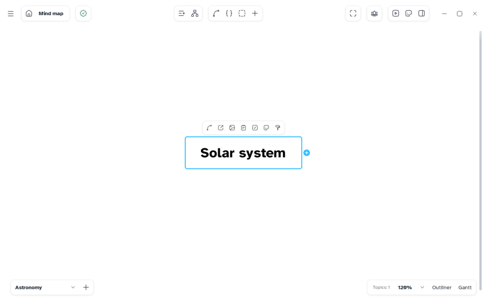

[Manual](../README.md) › [AI and MCP](README.md) › Work with an agent

# Work with an agent

Ask in plain words, and watch the map change in Mentis.

## Ask

- "Make a mind map of photosynthesis in my Biology folder, with a sticker on each main branch."
- "Read my map *Thesis plan* and give each writing task a duration of three days."
- "Export the map as a PDF next to it."

The agent names a map by its file, or uses **the map open in Mentis**: the window you used last,
saved or not. A new map it makes stays a file; it can open it in Mentis if you say yes.

## Watch it work

- The change appears at once, on the agent's sheet, with the topic selected.
- The bottom bar says what happened: **Agent: added "Calvin cycle"**.
- What you were typing is kept.

Each agent change is one undo step: <kbd>Ctrl</kbd>+<kbd>Z</kbd>.

## Answer its questions

Before something that cannot be undone, a window titled **Agent** asks, for example
*An agent wants to replace the file Notes.pdf.* Choose **Replace**, **Delete**, **Remove** or
**Open** to allow, or cancel. If Mentis is closed, the agent asks in its chat.

> [!NOTE]
> While a Mentis window or menu is open, the agent waits.

## Report a problem

Ask the agent for a bug report: it writes the text and gives a GitHub link. Nothing is sent
without you.
