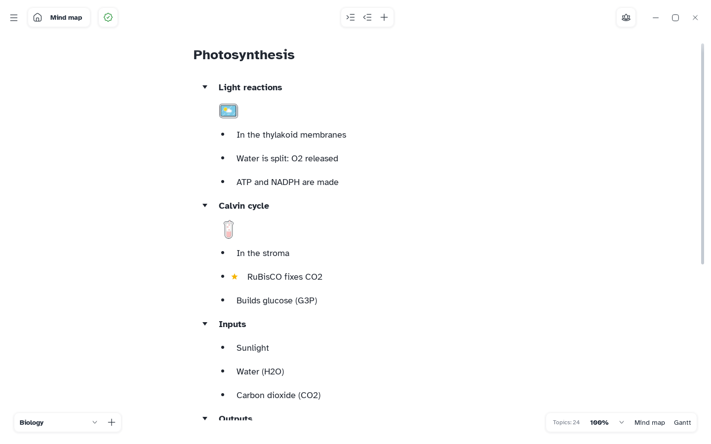

[Manual](../README.md) › [Files](README.md) › Word, Excel and Markdown

# Word, Excel and Markdown

Export the map as a Word outline, an Excel table or Markdown text.

## Export to Word or Excel

1. Choose **Main menu** › **Export** › **Word…** or **Excel…**.
2. Choose where to save the `.docx` or `.xlsx` file.

All sheets are exported. With a Gantt plan, choose **Mind map** or **Gantt** first (see
[Export a plan](../gantt/export.md)).

## Export to Markdown

1. Choose **Main menu** › **Export** › **Markdown…**.
2. Choose a name.

Mentis makes a folder with that name, holding:

- the `.md` file: titles and notes, indented by level;
- an `assets` folder with the topics' pictures and files.

Colours, positions and links between topics are left out.

> [!TIP]
> **Import** › **Markdown…** reads it back (see [Paste and import Markdown](../outliner/paste-and-import.md)).
