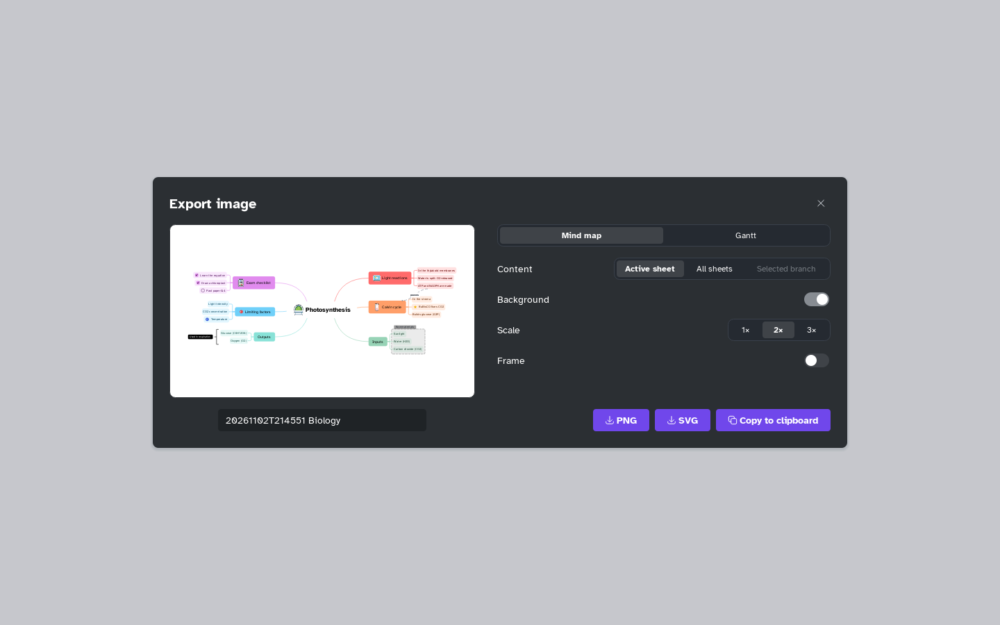

[Manual](../README.md) › [Files](README.md) › Export an image

# Export an image

Save the map as a picture, or copy it to the clipboard.

## Export an image

1. Choose **Main menu** › **Export** › **Image…**.
2. Set the options; the preview follows them.
3. Change the file name under the preview if you like.
4. Click **PNG**, **SVG** (sharp at any size) or **Copy to clipboard**.

| Option | Choices |
|---|---|
| **Content** | **Active sheet**, **All sheets** (one file each) or **Selected branch** |
| **Background** | On, or off for transparent |
| **Scale** | **1×**, **2×** or **3×** (PNG size) |
| **Frame** | A border, see [A frame around the map](export-pdf.md#a-frame-around-the-map) |

With a Gantt plan, the **Gantt** tab exports the plan (see [Export a plan](../gantt/export.md)).

> [!NOTE]
> A very large map is drawn at a smaller scale, and a message says so.
