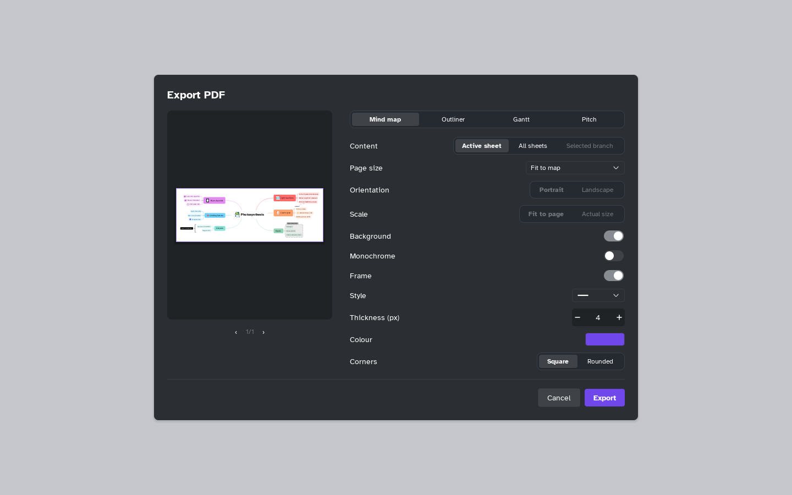

[Manual](../README.md) › [Files](README.md) › Export a PDF or print

# Export a PDF or print

Make a PDF of the map, outliner, Gantt plan or slides, or print them.

## Export a PDF

1. Choose **Main menu** › **Export** › **PDF…**.
2. Pick a tab: **Mind map**, **Outliner**, **Gantt** (with a plan) or **Pitch**
   (see [Export a presentation](../pitch/export.md)).
3. Set the options and check the pages with the arrows under the preview.
4. Click **Export**. Your choices are remembered.

| Option | Choices |
|---|---|
| **Content** | **Active sheet**, **All sheets** or **Selected branch** |
| **Page size** | **Fit to map** (one page), A3, A4, A5, Letter, Legal |
| **Orientation** | **Portrait** or **Landscape** |
| **Scale** | **Fit to page** or **Actual size** |
| **Background** | The map's colour, or white |
| **Monochrome** | Black and white, to save ink |

## Print

1. Choose **Main menu** › **File** › **Print…** (<kbd>Ctrl</kbd>+<kbd>P</kbd>).
2. Choose the **Printer** and **Copies**, then click **Print**.

## A frame around the map

Switch on **Frame** here or in **Export image**, then set:

- **Style**: Solid, Dashed, Dotted, Double, Greek key, Waves, Chain, Dentils
- **Thickness (px)**: 1 to 40
- **Colour**: any
- **Corners**: **Square** or **Rounded**

The frame is off each time the window opens.
