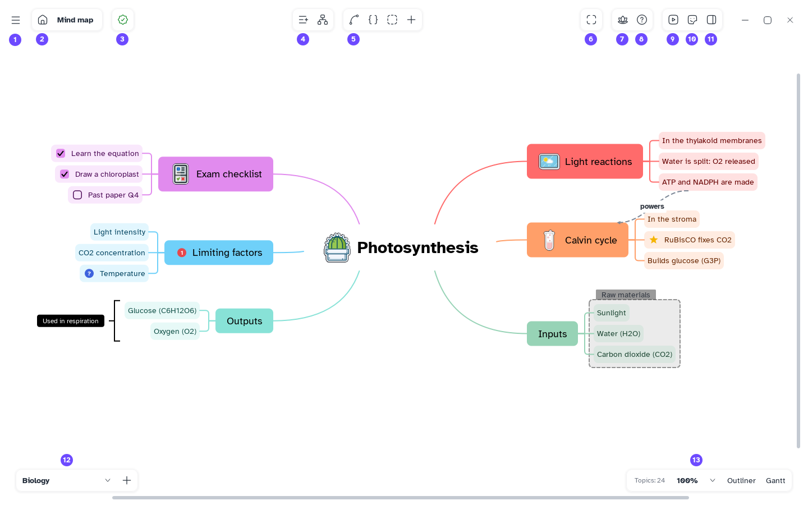

[Manual](../README.md) › [Files](README.md) › Save and open

# Save and open

A map is one `.mentis` file with all its sheets, pictures and attached files.

## Save a map

1. Press <kbd>Ctrl</kbd>+<kbd>S</kbd>, or **Main menu** › **Save**.
2. The first time, choose a folder and a name.

Then every change saves by itself. The button next to the house shows **Map saved**, **Changes to
save** or **Saving…**; click it to save at once.

**Save as…** (<kbd>Ctrl</kbd>+<kbd>Shift</kbd>+<kbd>S</kbd>) saves a copy; you then work on the copy.

> [!NOTE]
> Pictures and files are copied into the map: the `.mentis` file alone is complete.

## Open a map

- **Main menu** › **Open…** (<kbd>Ctrl</kbd>+<kbd>O</kbd>), or **Open local file** in the
  [Home](../getting-started/home.md).
- **Main menu** › **File** › **Open recent**: the last maps.
- A `.md` file opens as a new map (see [Paste and import Markdown](../outliner/paste-and-import.md)).

A map opens in one window at a time: again shows **File already open**.

## Fix a problem

- **Save error** says why a map cannot be saved; on closing, **Save failed** asks whether to close
  anyway.
- Saving is all or nothing: on failure the file keeps its last saved state.
- A damaged or non-Mentis file does not open, and is not changed.
