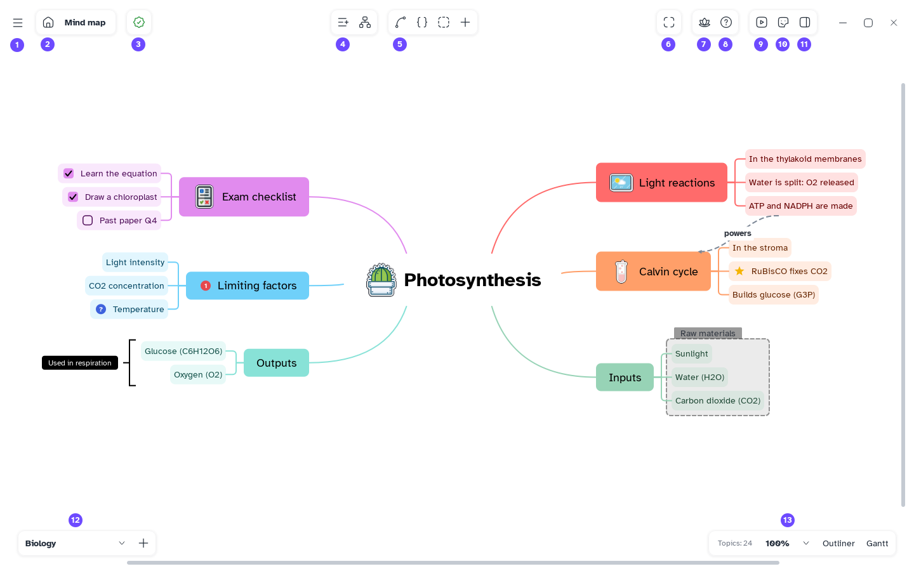

[Manual](../README.md) › [Files](README.md) › Undo and redo

# Undo and redo

Take back any change, step by step, and redo it.

## Undo and redo

- **Undo**: <kbd>Ctrl</kbd>+<kbd>Z</kbd>, or **Main menu** › **Undo**.
- **Redo**: <kbd>Ctrl</kbd>+<kbd>Y</kbd> or <kbd>Ctrl</kbd>+<kbd>Shift</kbd>+<kbd>Z</kbd>, or
  **Main menu** › **Redo**.

A typed title, a drag, a style change or a paste is one step.

## Undo on another sheet

The history covers all sheets. If the next step is on another sheet, the sheet list flashes and the
bottom bar names the sheet: go there to undo it.

Adding a sheet is not a step.

> [!NOTE]
> The history lasts while the map is open, older steps wait on disk. Opening or importing a file
> starts a new history.
