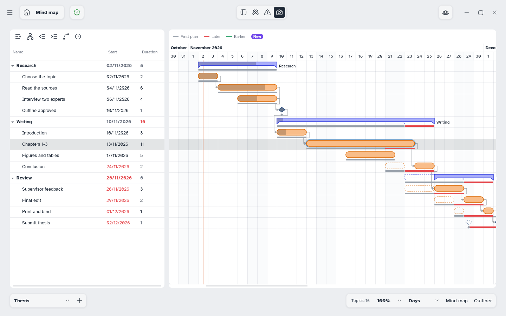

[Manual](../README.md) › [Gantt](README.md) › Baselines

# Baselines

A snapshot of the plan, to compare later with what really happened.

## Take a snapshot

1. Click **Baseline** (the camera) in the top bar.
2. Under **New snapshot**, keep the name (**Baseline 1**, **Baseline 2**…) or type another, and click **Save**.

The list shows snapshots newest first, with date and time. The pencil renames one; **×** deletes it.

## Compare with a snapshot

Click it in the list; click it again or **None** to stop.

- A thin grey bar under each bar shows its old place.
- The part that slipped is red (later) or green (earlier).
- A dashed outline marks the old place of a moved task.
- A task added since has a **New** pill.
- Changed dates and durations are red or green in the table; hover for the old value.

The critical path is hidden while you compare.
