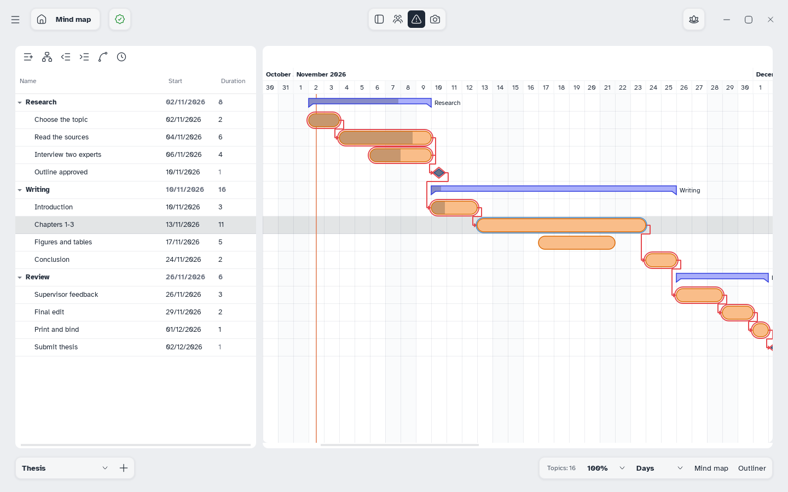

[Manual](../README.md) › [Gantt](README.md) › Dependencies

# Dependencies

A dependency makes a task wait for another: move the first and the others follow.

## Link two tasks

- **Draw**: hover a bar and drag the circle at its end onto the next task (or at its start onto the one before). A forbidden cursor means the link is not possible, such as a loop.
- **Chain**: select tasks in order and click **Link in a chain** (<kbd>Ctrl</kbd>+<kbd>Shift</kbd>+<kbd>L</kbd>). With links already there it is **Remove links**.
- **Panel**: **+ Add** in **Predecessors** or **Successors**.

## Change the type and lag

Right-click an arrow; hover it to read its type and lag.

| Type | The second task… |
|---|---|
| **Finish to start** | starts when the first ends (usual) |
| **Start to start** | starts when the first starts |
| **Finish to finish** | ends when the first ends |
| **Start to finish** | ends when the first starts |

**Lag…** sets the working days between them; a negative number is a lead. **Delete dependency** removes the arrow. Dragging a linked bar changes the lag, not the link.

## Show the critical path

Click **Critical path** in the top bar. Critical tasks get a red halo and red arrows: if one is late, the plan ends later. Click again to hide it.
