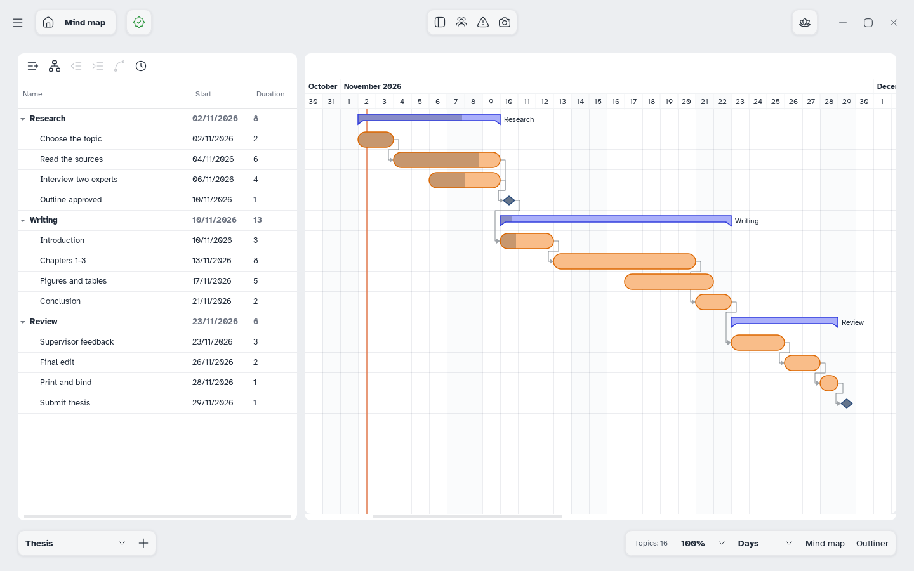

[Manual](../README.md) › [Gantt](README.md) › Export a plan

# Export a plan

Print the plan or export it as PDF, image, Word or Excel, with the costs if needed.

## Export

1. Open the Gantt view.
2. Choose **Main menu** › **Export** › **PDF…**, **Image…**, **Word…**, **Excel…** or **Print…**. The window opens on its **Gantt** tab.
3. Choose the options:

| Option | Choices |
|---|---|
| **Content** | **Gantt**, **Gantt and costs** or **Costs** (PDF, print, Word, Excel) |
| **Time unit** | Days, Weeks or Months |
| **Scale** (PDF, print) | **Fit width** or **Actual size**; landscape at first |

With **Fit width**, Mentis may pick a larger time unit to keep text legible, or use more pages; a note says so. The columns follow the table. A snapshot being compared is exported too.

## Include the costs

**Costs** adds a table per task (**Task**, **People**, **Hours**, **Cost**) and per person (**Person**, **Role**, **Hourly cost**, **Hours**, **Cost**), with their **Total**. In Excel, a **Per week** sheet gives each person's hours week by week.

> [!NOTE]
> A very large plan may not fit in an image: export it as a PDF.
