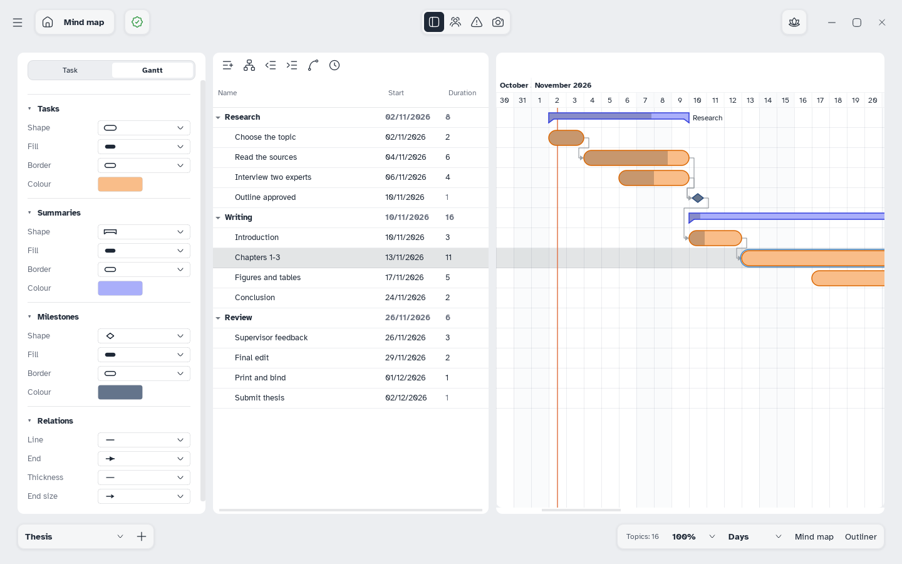

[Manual](../README.md) › [Gantt](README.md) › Gantt style

# Gantt style

Choose how tasks, summaries, milestones and arrows look, for the whole plan or one task.

## Style the whole plan

Open the side panel › **Gantt**. Each section has **Shape**, **Fill**, **Border** and **Colour**:

| Section | Shapes |
|---|---|
| **Tasks** | Pill, Rounded rectangle, Rectangle, Arrow, Hexagon, Leaf, Ticket, Parallelogram |
| **Summaries** | Bar, Bracket, Brace, Horizontal I, Hook, Dimension line, Arrow, Pinned rail, Group frame |
| **Milestones** | Diamond, Circle, Triangle, Star, Hexagon, Heart, Flag, Gem |

Fills and borders are those of [topics](../style/topic-style.md). **Relations** sets the arrows: **Line**, **End**, **Thickness**, **End size**. The choices belong to the sheet and are saved in the file.

## Style one task

In the **Task** tab, **Style** changes only the selected tasks; its **×** buttons go back to the plan's style.

Or: right-click a row › **Colour…**, **Default colour**, **Copy style**, **Paste style**.

## Show the name on the bar

Switch on **Name on the bar**. Summaries show it at first, tasks and milestones do not.
