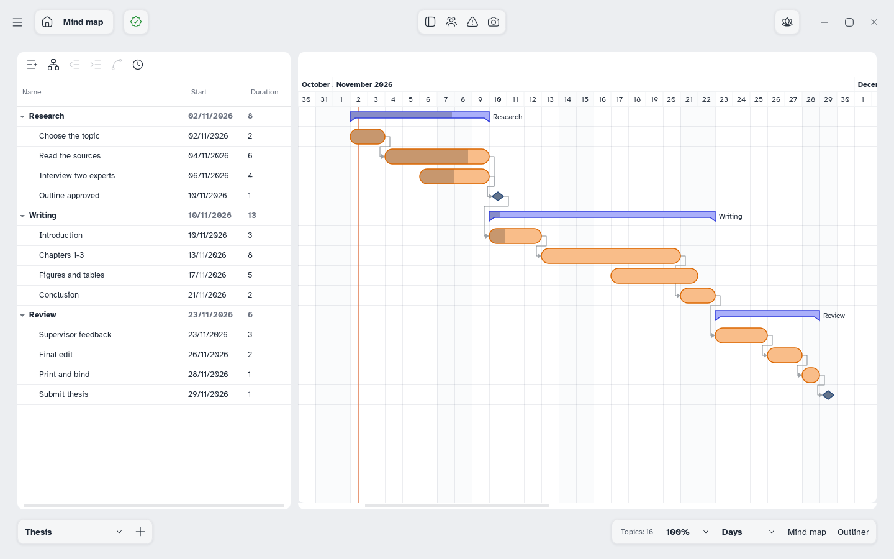

[Manual](../README.md) › [Gantt](README.md) › The Gantt view

# The Gantt view

The sheet as a plan: a table of tasks on the left, their bars on a timeline on the right.

## Open the Gantt view

Click **Gantt** at the bottom right or press <kbd>Ctrl</kbd>+<kbd>Alt</kbd>+<kbd>G</kbd>. **Mind map** or **Outliner** goes back.

Or: **Main menu** › **View** › **Gantt**.

## Read the rows

- Every topic except the central one is a row, in map order. Changes go both ways.
- A topic with subtopics is a **summary**: bold, foldable, with dates and progress taken from its subtopics.
- A topic without a start date has no bar.

## Choose the columns

Right-click a column header to show or hide **No.**, **Name**, **Start**, **End**, **Duration**, **%**, **Priority** and **People**; drag a header to reorder. **No.** appears when the map is numbered.

## Read the timeline

- Grey days are days off; an orange line marks today.
- Tasks are pills, summaries brackets or bars, milestones diamonds; the darker part is the work done.
- Hover a bar for its dates, working days and float: how many days it can slip without moving the end of the plan.

## Move and zoom

Choose **Days**, **Weeks** or **Months** at the bottom right, next to the zoom. The wheel scrolls up and down, <kbd>Shift</kbd>+wheel sideways, <kbd>Ctrl</kbd>+wheel zooms.
