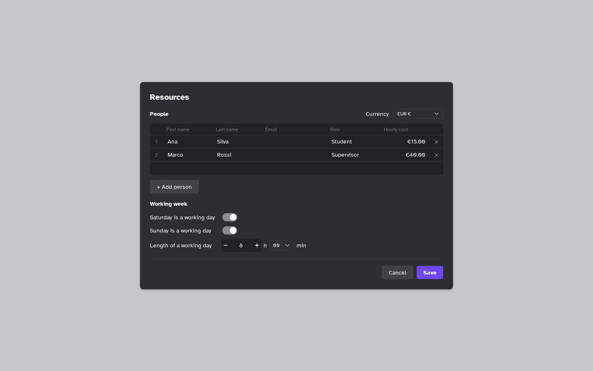

[Manual](../README.md) › [Gantt](README.md) › People and costs

# People and costs

List the project's people, give them tasks, and Mentis counts hours and costs.

## Add people and the working week

1. Click **Resources** in the top bar.
2. Click **+ Add person**: **First name**, **Last name**, **Email**, **Role**, **Hourly cost**. Drag a row's number to reorder; **×** removes.
3. Choose the **Currency**: EUR, USD, GBP, CHF, or **+ Add currency…** with a code and a symbol.
4. Under **Working week**, set **Saturday**, **Sunday** and **Length of a working day** (8 hours at first), then **Save**.

Days off stretch tasks on the timeline.

## Assign people to tasks

1. Select tasks and open the side panel.
2. In **Resources**, click **+ Add** and choose a person.
3. In **%**, set their share of the task (100 % = the whole time).

**×** removes them. A person on only some of the selected tasks is dimmed. The **People** column lists the names.

## Read the costs

Cost = working days × length of the working day × share × hourly cost. Choose **Gantt and costs** or **Costs** when you [export the plan](export.md).
