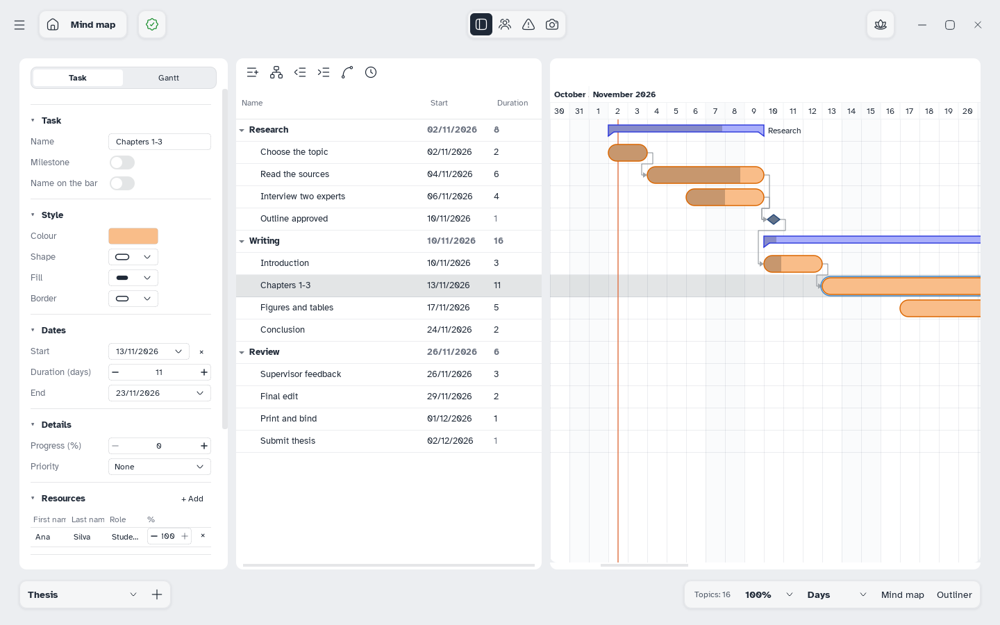

[Manual](../README.md) › [Gantt](README.md) › Tasks

# Tasks

Add tasks, give them dates and a duration, and follow their progress.

## Add and arrange tasks

- **Add task**: <kbd>Enter</kbd>, below the selected one. **Add subtask** adds one inside it.
- **Level down**: <kbd>Tab</kbd>. **Level up**: <kbd>Shift</kbd>+<kbd>Tab</kbd>.
- **Delete**: <kbd>Delete</kbd>, or right-click › **Delete**.
- **Move**: drag a task's name onto another row; its branch moves on the map too.

**Go to today** brings the timeline to today.

## Set dates and progress

- **In the table**: double-click a cell or press <kbd>F2</kbd>. **Start** and **End** open a calendar; **Duration** counts working days; **%** is the work done.
- **On the timeline**: drag a bar to move it, its right edge for the duration, the handle under the done part for progress.
- Right-click › **Remove date** takes the task off the timeline.

## Use the task panel

Click **Show/hide side panel** and select one or more tasks; the panel changes all of them.

| Section | Fields |
|---|---|
| **Task** | **Name**, **Milestone**, **Name on the bar** |
| **Style** | **Colour**, **Shape**, **Fill**, **Border** of the bar |
| **Dates** | **Start**, **Duration (days)**, **End**, or **Add date** |
| **Details** | **Progress (%)**, **Priority** (None to Very high) |
| **Resources** | The [people](people-and-costs.md) on the task |
| **Predecessors** / **Successors** | Its [dependencies](dependencies.md) |

**Delete** at the bottom removes the task and its topic, after a question.

## Make a milestone

Switch on **Milestone**: the task becomes a diamond without duration, done or not done. On the map it is a topic with a checkbox.
