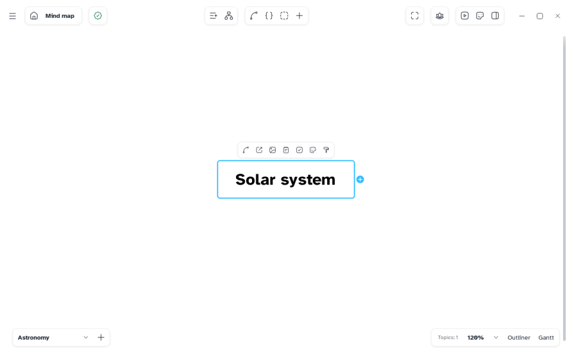
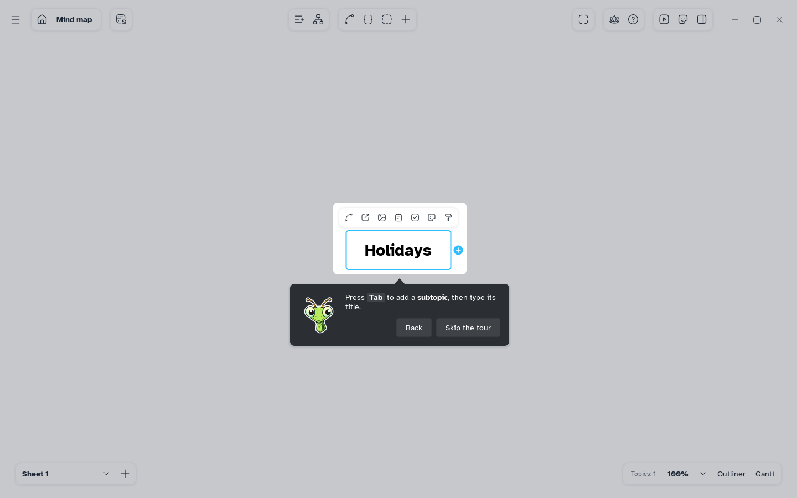
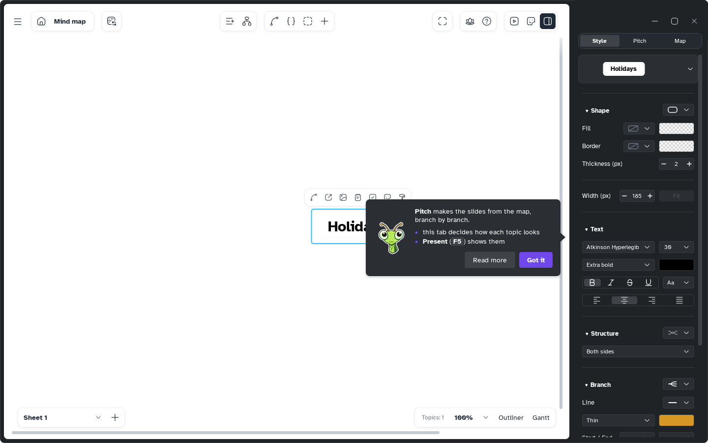

[Manual](../README.md) › [Getting started](README.md) › Your first map

# Your first map

Build a map with <kbd>Tab</kbd> and <kbd>Enter</kbd>, save it once, and Mentis saves the rest.

## The guided tour

At first start the mascot offers a two-minute tour on a practice map: **Start the tour** or
**Not now**. It lights each area in turn: the topic bar and the bar for selected words, the top bar,
the side panel and its pages, markers and stickers, Pitch, focus mode, sheets, the views, then the
outliner and the Gantt, and back on the map the save state. The rest is for you to discover; **Report a bug** opens the page to tell us about one. Some steps wait for you to do them (a title, <kbd>Tab</kbd>, <kbd>Enter</kbd>, a drag,
a colour).

- **Back** returns to a step; **Skip the tour** or <kbd>Esc</kbd> ends it.
- At the end, **Keep the map** saves it with a name; **Discard it** goes back to the Home.
- Start it again: **Main menu** › **Help** › **Guided tour** › **Mind map**, or **Settings** ›
  **General** › **Restart the tour**.

The outliner and the Gantt also have their own short tour, in **Main menu** › **Help** › **Guided
tour**; if you did not start the map's tour, each is offered the first time you open them (**Show me** or
**Not now**). The first time you
open the Pitch tab a tip appears: **Got it** closes it, **Read more** opens this manual. Turn offers
and tips off in [Settings › General](../settings/general.md#guide).

## Add topics

1. Create a map from the [Home](home.md). The central topic is selected.
2. Press <kbd>Tab</kbd> for a **child** and type its title.
3. Press <kbd>Enter</kbd> to finish, then <kbd>Enter</kbd> again for a **sibling**.

Or: **Add sibling** and **Add a child to the selected node** in the top bar. Drag a topic to move
its branch; <kbd>Ctrl</kbd>+<kbd>Z</kbd> undoes, <kbd>Ctrl</kbd>+<kbd>Y</kbd> redoes. More in
[Topics](../map/topics.md).

## Save

1. Press <kbd>Ctrl</kbd>+<kbd>S</kbd>.
2. Choose a folder and a name: the map becomes one `.mentis` file.

From then on every change is saved by itself; the check mark at the top left shows it.

> [!TIP]
> A map never saved is not lost if the computer stops: Mentis keeps a working copy.
