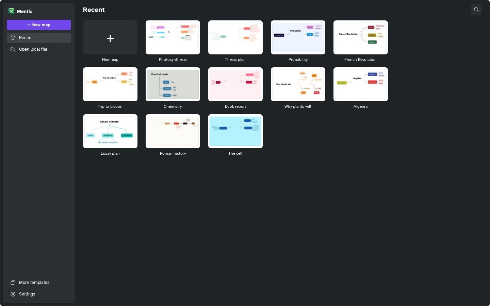

[Manual](../README.md) › [Getting started](README.md) › The Home

# The Home

The Home is where Mentis starts: recent maps, new maps and files on your computer.

## Open a recent map

Click a card. To find one, click the search button at the top right and type in
**Search recent maps**.

## Create a map

1. Click **New map**.
2. Choose a map type.
3. Click **Create**.

Or: **More templates** › **Free map**, **Classic mind map**, **Project**, **Night theme**,
**Brainstorming**, **SWOT analysis** or **Action plan**. In the editor, <kbd>Ctrl</kbd>+<kbd>N</kbd>
creates a classic mind map at once.

## Open a file

Click **Open local file** (<kbd>Ctrl</kbd>+<kbd>O</kbd>) and choose a `.mentis` file.

## Go back to the Home

Click the house at the top left (**Open the library**) or press
<kbd>Ctrl</kbd>+<kbd>Shift</kbd>+<kbd>H</kbd>. Mentis asks first if there are unsaved changes.
