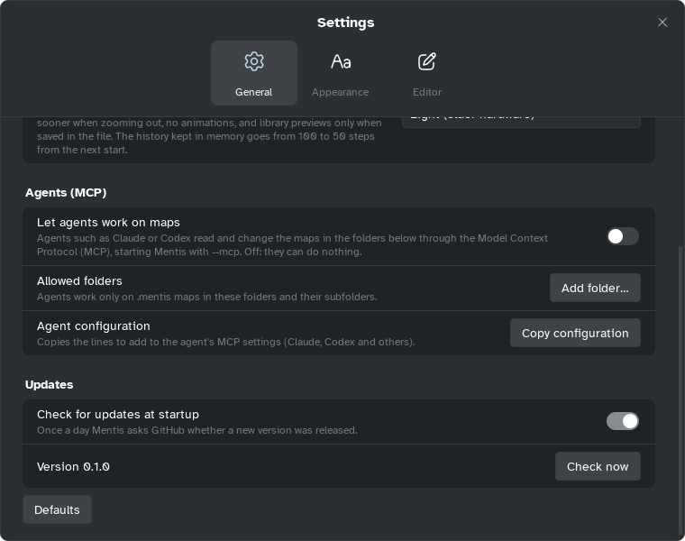

[Manual](../README.md) › [Getting started](README.md) › Install Mentis

# Install Mentis

Download Mentis from [Releases](https://github.com/simozock/Mentis/releases); no administrator
rights needed.

## Install on Windows

1. Download `Mentis-<version>-setup-x64.exe`.
2. Open it and follow the steps. It installs for your account only, in
   `%LOCALAPPDATA%\Programs\Mentis`.
3. Start Mentis from the Start menu.

If **Windows protected your PC** appears, click **More info** › **Run anyway**. To remove Mentis:
Windows **Settings** › **Apps** › **Installed apps** › **Uninstall**. Your maps stay.

## Install on Linux

1. Download `Mentis-<version>-x86_64.AppImage`.
2. Run `chmod +x Mentis-*-x86_64.AppImage`, then `./Mentis-*-x86_64.AppImage`.

It needs glibc 2.35 or newer (Ubuntu 22.04 and later).

## Install on macOS

No package yet: build from source with [BUILD.md](../../BUILD.md).

## Updates

Once a day at startup Mentis asks GitHub for a new version, and if there is one:

| Choice | What happens |
|---|---|
| **Update** | Windows: downloads and checks the installer, saves your maps, restarts on the new version. |
| **Open release page** | macOS, Linux and copies not installed with the installer: opens the page in the browser. |
| **Skip this version** | Not proposed again at startup. |
| **Later** | Asks again at a later start. |

**Settings** › **General** › **Updates**: **Check for updates at startup** turns it off; **Check
now** checks at once, skipped versions too.

> [!NOTE]
> This is the only time Mentis connects to the internet on its own.
