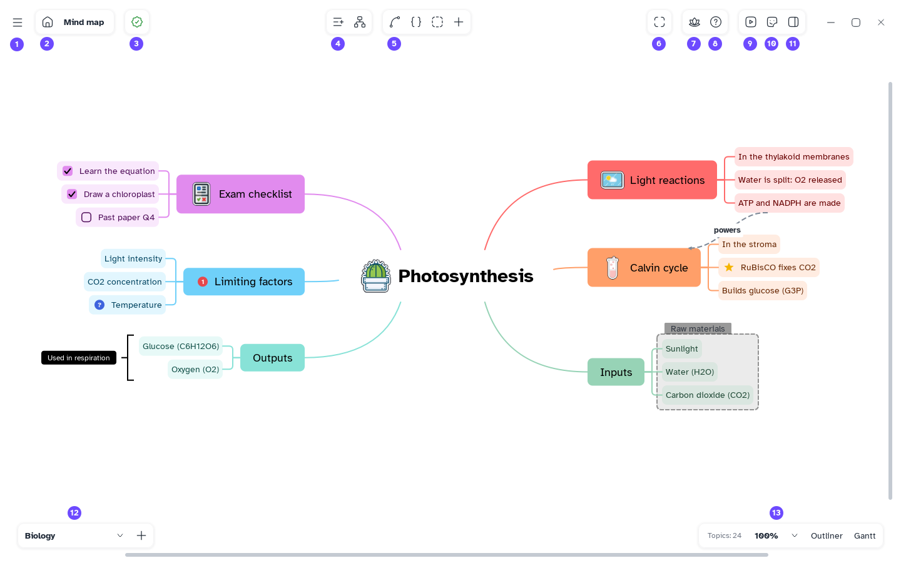
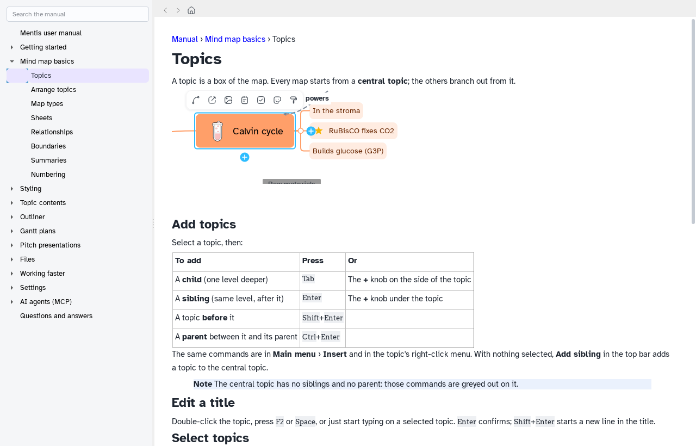

[Manual](../README.md) › [Getting started](README.md) › The window

# The window

The map fills the window; the commands float around it in small groups.

1. **Main menu**: files, import and export, undo, settings.
2. **Open the library**: back to the [Home](home.md).
3. **Save state**: a check mark when saved; hover it for details.
4. **Add sibling** and **Add a child to the selected node**.
5. **Relationship**, **Summary**, **Boundary**, **Insert content**: arrows, brackets, frames, and
   notes, links, labels, tasks, stickers, files and more.
6. **Fit to window**: the whole map in view.
7. **Focus mode**: the map only, full screen.
8. **User manual**: this manual (<kbd>F1</kbd>).
9. **Present**: the map as a slide show.
10. **Markers and stickers**: icons and pictures for topics.
11. **Side panel**: the **Format panel**: the style of the selected topics, or of the map (type,
    theme, background) when nothing is selected.
12. **Sheets**: choose a sheet or add one with **+**.
13. **Topics**, **zoom** and the views: map, **Outliner** (an indented list), **Gantt** (tasks on
    a timeline).

## Open the manual

Press <kbd>F1</kbd> or click **User manual**: the page about what you are doing opens, without
internet. Windows with a page show a **?** next to their title.

- **Search the manual** and the contents are on the left.
- The arrows go back and forward.
