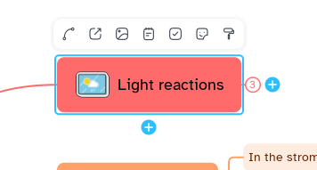

[Manual](../README.md) › [Map](README.md) › Arrange topics

# Arrange topics

Move branches, change their order and fold the ones you do not need.

## Move a branch

1. Drag a topic; a blue preview shows where it goes.
2. Drop it above or below a sibling to reorder, on a topic to make it a child, across the centre
   line to change side, or on the empty map to make it floating. <kbd>Esc</kbd> cancels.

Or: <kbd>Alt</kbd>+<kbd>Up</kbd> / <kbd>Alt</kbd>+<kbd>Down</kbd> (**Move topic up**, **Move topic
down**). **Auto layout** (<kbd>Ctrl</kbd>+<kbd>L</kbd>) puts every topic back in place.

## Collapse a branch

- Click the round control where the branches start; a number shows the hidden topics. Click it to
  expand.
- <kbd>Ctrl</kbd>+<kbd>/</kbd> for the branch, <kbd>Ctrl</kbd>+<kbd>Alt</kbd>+<kbd>/</kbd> for its
  sub-branches.
- Or: right-click › **Collapse branch**, **Expand branch**, **Collapse all sub-branches**,
  **Expand all**.

## Add a floating topic

1. Click **Insert content** › **Floating topic**.
2. Click on the map. <kbd>Esc</kbd> cancels.

It can have children and relationships. Right-click › **Arrange** brings it to the front or back.

## Keep branches where you put them

**Format panel** › **Map** › **Free branch positions** turns off automatic layout and balancing.
