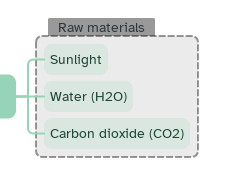

[Manual](../README.md) › [Map](README.md) › Boundaries

# Boundaries

A boundary is a titled frame around topics that belong together.

## Add a boundary

1. Select a topic, or several with <kbd>Ctrl</kbd>+click.
2. Click **Boundary** in the top bar or press <kbd>Ctrl</kbd>+<kbd>Shift</kbd>+<kbd>B</kbd>.

Siblings share one boundary; topics with different parents get one each. The central topic has none.

## Edit the title

Double-click the title, or select the boundary and type.

## Style it

Select it, then side panel › **Style**:

| Option | Choices |
|---|---|
| **Shape** | Rounded rectangle, Rectangle |
| **Fill** | Color |
| **Border** | Style, width and color |

## Delete it

Select it and press <kbd>Delete</kbd>. The topics stay.
