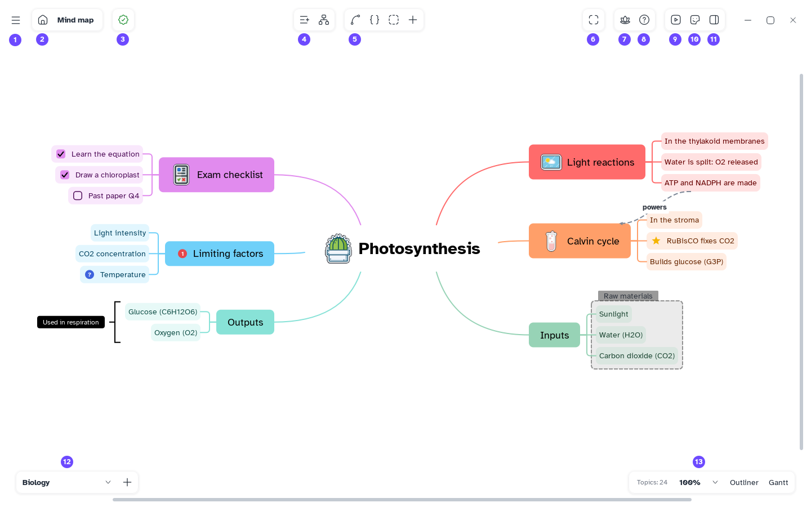

[Manual](../README.md) › [Map](README.md) › Focus mode

# Focus mode

Focus mode fills the whole screen with Mentis: no taskbar, no other windows.

## Turn it on

Click **Focus mode** at the top right (the lotus, next to **Fit to window**), or press
<kbd>Ctrl</kbd>+<kbd>Alt</kbd>+<kbd>F</kbd>.

Or: **Main menu** › **View** › **Focus mode**.

## Turn it off

Press <kbd>Esc</kbd>, the same keys, or the button again. The window goes back to its size.

The map, the outliner, the Gantt view and the panels keep working as usual. For a slide show, see
[Present](../pitch/present.md).
