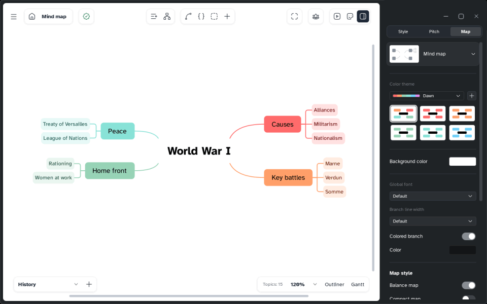
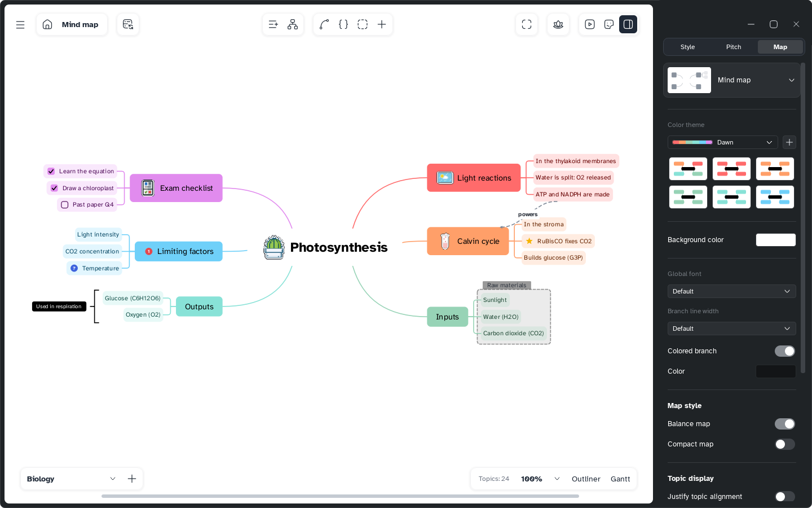

[Manual](../README.md) › [Map](README.md) › Map types

# Map types

The same topics can take many shapes, and you can change the type at any time.

## Change the map type

1. Click an empty spot so that nothing is selected.
2. Open the side panel, **Map** tab.
3. Click the map type card and choose a picture.

| Type | Good for |
|---|---|
| **Mind map** | Ideas around a centre, on both sides |
| **Logic chart** | A topic opening to the right |
| **Brace map** | Parts of a whole |
| **Org chart** | Levels from the top down |
| **Tree chart** | A tree growing down, one side |
| **Timeline** | Events in order |
| **Fishbone** | Causes leading to an effect |
| **Tree table** | Topics as rows and columns |

Each type has several variants.

## Give one branch its own shape

1. Select the topic where the branch starts.
2. Side panel › **Style** › **Structure**.
3. Choose a type (or **Same as parent**) and a direction: **Both sides**, **Right**, **Left**,
   **Down**, **Up** or **Off axis**.

## Balance the map

**Map** tab › **Balance map** spreads the main branches evenly over both sides. Not available for
one-sided maps or with **Free branch positions** on.

> [!NOTE]
> Tree tables have no summaries and no boundaries.
