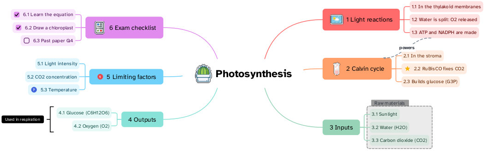

[Manual](../README.md) › [Map](README.md) › Numbering

# Numbering

Numbers in front of the topics show their order: 1, 2, 3, then 1.1, 1.2 below.

## Number the branches

1. Select the topic whose branches to number; the central topic numbers the whole map.
2. Side panel › **Style** › **Numbering**.
3. Choose **1.2.3**, **A.B.C**, **a.b.c** or **I.II.III**. **None** removes them.

Or: the same choice on the **Map** page, for the whole map.

## Change the options

| Option | What it does |
|---|---|
| **Format** | One symbol per level: `1`, `A`, `a`, `I` or `i` (for example `I.A.1`). |
| **Separator** | `.`, `)` or `-` |
| **First number** | Where counting starts. |
| **Type** | **Hierarchical** (1.1, 1.2) or **By level** (each level counts on its own). |
| **Levels** | **All**, or how many levels. |

Move a topic and the numbers follow.
