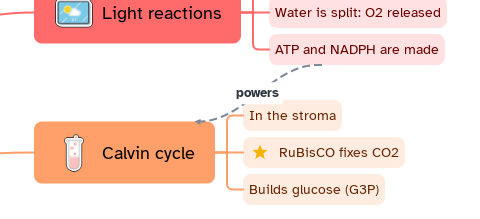

[Manual](../README.md) › [Map](README.md) › Relationships

# Relationships

A relationship is an arrow between two elements of the map, wherever they are.

## Create a relationship

1. Select the topic where the arrow starts.
2. Click **Relationship** in the top bar or the topic bar, or press
   <kbd>Ctrl</kbd>+<kbd>Shift</kbd>+<kbd>R</kbd>.
3. Click where it ends: a topic, a [boundary](boundaries.md) or a [summary](summaries.md).
   <kbd>Esc</kbd> cancels.

With nothing selected, **Relationship** in the top bar creates a floating topic.

## Edit it

- **Label**: double-click the line, or select it and type. <kbd>Enter</kbd> confirms.
- **Curve**: drag the two round handles.
- **Ends**: drag an end onto another element.

## Style it

Select it, then side panel › **Style**:

| Option | Choices |
|---|---|
| **Shape** | Curved, Straight, Elbow |
| **Line** | Solid line, Dashed line, Dotted; width and color |
| **Start / End** | None, Open arrow, Filled arrow, Dot, Square, Diamond |
| **Text** | Font, size and color of the label |

A new one is dashed, thin, with a filled arrow at the end.

## Delete it

Select it and press <kbd>Delete</kbd>, or right-click › **Delete**.
