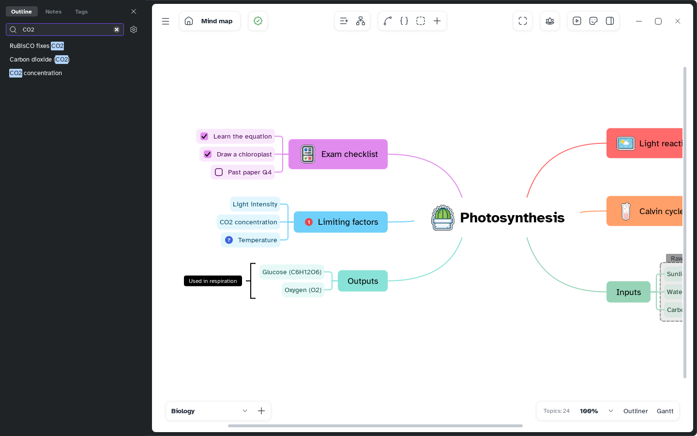

[Manual](../README.md) › [Map](README.md) › Search and replace

# Search and replace

Find topics by title, note, label or link, and replace words in many titles at once.

## Find

1. Press <kbd>Ctrl</kbd>+<kbd>F</kbd> or choose **Main menu** › **View** › **Find**. The
   **Outline** tab opens on the left.
2. Type in **Find**; a match in a note, label or link shows a piece of it.
3. Click a result to go to it. <kbd>Enter</kbd> goes to the first.

An empty field shows the map as a tree. <kbd>Esc</kbd> or **×** closes the panel.

## Set the options

The gear (**Search options**):

| Option | Choices |
|---|---|
| Mode | **Find** or **Find and replace** |
| Where | **Current map** or **Current file** (every sheet) |
| How | **Whole words**, **Match case** |
| In | **Topic**, **Note**, **Tag**, **Link** |

## Replace

1. Choose **Find and replace**.
2. Type in **Replace**.
3. Click **Replace** or **Replace all**.

Only topic titles change.

## Browse notes and labels

- **Notes** tab: topics with a note; **Search notes** filters them.
- **Tags** tab: the [labels](../topic-contents/labels.md) and their counts. Click one to highlight
  its topics; right-click › **Rename** (<kbd>F2</kbd>) or **Delete** (<kbd>Delete</kbd>) in every
  sheet.
