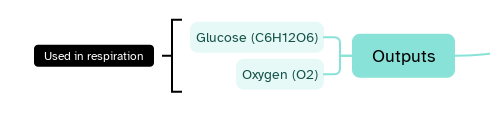

[Manual](../README.md) › [Map](README.md) › Summaries

# Summaries

A summary is a bracket beside some topics with a topic of its own: the conclusion of a group.

## Add a summary

1. Select sibling topics (<kbd>Ctrl</kbd>+click for more than one).
2. Click **Summary** in the top bar.
3. Double-click the summary topic to give it a title.

The central topic and tree tables have no summaries.

## Edit it

Edit and style the summary topic like any topic. It has no siblings, but it can have subtopics:
click the **+** beside it or press <kbd>Tab</kbd>. They grow into a branch away from the bracket, where
every topic works as in the map. The branch is not shown in the Outliner.

## Delete it

Select the summary topic and press <kbd>Delete</kbd>: the bracket goes with its branch, the topics stay.
