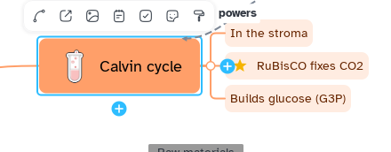

[Manual](../README.md) › [Map](README.md) › Topics

# Topics

A topic is a box of the map. Every map grows from the **central topic**.

## Add a topic

Select a topic, then:

- **Child**: <kbd>Tab</kbd>
- **Sibling**: <kbd>Enter</kbd>
- **Topic before**: <kbd>Shift</kbd>+<kbd>Enter</kbd>
- **Parent**: <kbd>Ctrl</kbd>+<kbd>Enter</kbd>

Or: the **+** knobs on the topic, or **Main menu** › **Insert**.

> [!NOTE]
> The central topic has no sibling or parent.

## Edit the title

Double-click the topic, press <kbd>F2</kbd> or <kbd>Space</kbd>, or just start typing.
<kbd>Shift</kbd>+<kbd>Enter</kbd> starts a new line.

## Select topics

- Click, or move with the arrow keys.
- <kbd>Ctrl</kbd>+click or <kbd>Shift</kbd>+click adds to the selection.
- Drag on the empty map to select an area.
- **Main menu** › **Select** picks subtopics, siblings, same level and more.
- <kbd>Ctrl</kbd>+<kbd>R</kbd> goes back to the central topic.

## Copy and delete

Right-click › **Cut**, **Copy**, **Paste** or **Duplicate**. **Paste** adds the branch as the last
child of the selected topic; text from another app becomes a list of topics. <kbd>Delete</kbd>
removes the topic and its branch.

## Use the topic bar

A selected topic shows a small bar above it: relationship, link, image, note, checkbox, sticker
and style.
