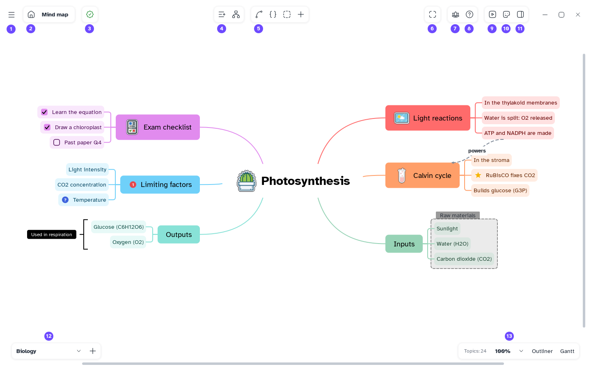

[Manual](../README.md) › [Map](README.md) › Zoom and move around

# Zoom and move around

Zoom in on a detail, step back to see the whole map, and move across it.

## Zoom

- <kbd>Ctrl</kbd>+mouse wheel, or <kbd>Ctrl</kbd>+<kbd>+</kbd> / <kbd>Ctrl</kbd>+<kbd>-</kbd>.
- The box at the bottom right: type a value or pick one from 25 to 400 %.
- **Fit to window**: <kbd>Ctrl</kbd>+<kbd>0</kbd>, or its button at the top right.
- **Main menu** › **View** › **Actual size**: back to 100 %.

The outliner and the Gantt view have their own zoom, with the same commands.

## Move around

- The mouse wheel scrolls up and down; <kbd>Shift</kbd>+wheel scrolls sideways.
- Drag with the **middle mouse button** to move in any direction.
- The arrow keys move from topic to topic, and the map follows.
- <kbd>Ctrl</kbd>+<kbd>R</kbd> goes back to the central topic.
