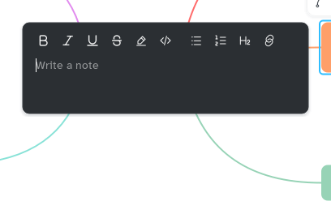

[Manual](../README.md) › [Outliner](README.md) › Markdown shortcuts

# Markdown shortcuts

Type Markdown symbols and the text is formatted as you write: in map titles, the outliner and notes.

## Format while typing

| Type | You get |
|---|---|
| `**text**` | **bold** |
| `*text*` | *italic* |
| `~~text~~` | ~~strikethrough~~ |
| `==text==` | highlighted text |
| `- [ ] ` or `[ ] ` at the start of a title | an empty checkbox |
| `- [x] ` at the start of a title | a ticked checkbox |
| `- ` at the start of a line (notes) | a bulleted list |
| `1. ` at the start of a line (notes) | a numbered list |
| `## ` at the start of a line (notes) | a heading |
| `[text](address)` (notes) | a link; <kbd>Ctrl</kbd>+click opens it |
| `` `code` `` (notes) | code, in a monospaced font |

The change happens on the closing symbol, or on the space after `- `, `1. ` and `## `. A symbol must touch the words: `2 * 3 * 4` stays as it is. Nothing changes inside a `$formula$` or code.

## Undo a change

Press <kbd>Ctrl</kbd>+<kbd>Z</kbd> right after it: the symbols come back as typed. To remove a format later, use its button in the text's small bar.

## Turn the shortcuts off

Open **Settings** › **Editor** and switch off **Markdown shortcuts**.
