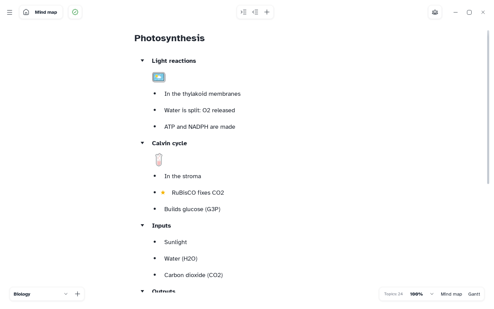

[Manual](../README.md) › [Outliner](README.md) › The outliner

# The outliner

The sheet as a list, one row per topic, indented by level. Every change appears on the map at once.

## Open the outliner

Click **Outliner** at the bottom right or press <kbd>Ctrl</kbd>+<kbd>Shift</kbd>+<kbd>M</kbd>. The same button, now **Mind map**, brings the map back.

Or: **Main menu** › **View** › **Outliner**.

## Write

- **Edit a title**: click its row. <kbd>Shift</kbd>+<kbd>Enter</kbd> starts a new line.
- **New item**: <kbd>Enter</kbd>. In the top title it adds a first-level row.
- **Indent**: <kbd>Tab</kbd>. **Outdent**: <kbd>Shift</kbd>+<kbd>Tab</kbd>, or <kbd>Backspace</kbd> in an empty title.
- **Add content**: **Add content to the branch** at the top (text, formula, image, note, sticker, marker, file, label, checkbox).

Select words to get a small bar: **Bold**, **Italic**, **Strikethrough**, **Underline**, **Highlight**.

## Select, move and fold

- <kbd>Ctrl</kbd>+click adds a row to the selection, <kbd>Shift</kbd>+click a range, <kbd>Esc</kbd> goes back to one.
- Drag a row by its six dots to move it with its branch.
- Click the bullet of a row with children to fold it; it shows how many rows it hides.

## Copy and delete

Right-click a row › **Copy** (<kbd>Ctrl</kbd>+<kbd>C</kbd>), **Cut**, **Paste**, **Duplicate** (<kbd>Ctrl</kbd>+<kbd>D</kbd>), **Delete** (<kbd>Delete</kbd>), **Clear text**, **Copy style** or **Paste style**.

## Zoom

<kbd>Ctrl</kbd>+mouse wheel, or the zoom at the bottom right: 50 to 300 %, separate from the map.
