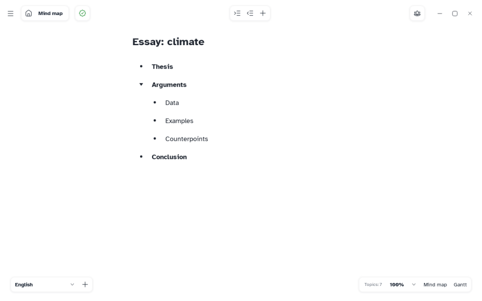

[Manual](../README.md) › [Outliner](README.md) › Paste and import Markdown

# Paste and import Markdown

Bring notes from another app into a map: paste a Markdown list into the outliner, or import a `.md` file.

## Paste into the outliner

1. Copy the text in the other app.
2. Select the row after which it goes, or nothing to add it at the end.
3. Press <kbd>Ctrl</kbd>+<kbd>V</kbd>. Up to 5,000 items, in one step of undo.

| In the text | In the map |
|---|---|
| Headings `#` to `######`, indented lists | Levels of topics |
| A paragraph under an item | The note of that topic |
| `**bold**`, `*italic*`, `~~strikethrough~~` | The same formatting |
| `1.` or `2)` before an item | A topic, without the number |
| `$formula$` | A formula |
| `#tag` at the end of an item | A label (`_` becomes a space) |
| `[text](address)` | Just the text |
| Text without headings or lists | One topic per line |

> [!WARNING]
> A list of two or more items pasted into the **title at the top** replaces the whole map; the first item becomes the central topic. <kbd>Ctrl</kbd>+<kbd>Z</kbd> brings the old map back.

## Import a Markdown file

1. Choose **Main menu** › **Import** › **Markdown…**, or **Open…**.
2. Pick a `.md` or `.markdown` file. Mentis asks to save the current map first.

The file becomes a new map, by the same rules; the first top-level item is the central topic.
