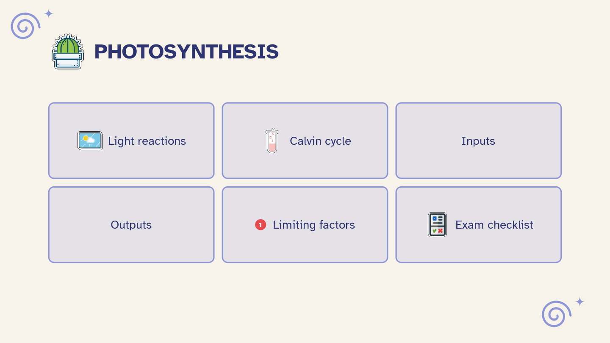

[Manual](../README.md) › [Pitch](README.md) › Export a presentation

# Export a presentation

Take the slides out of Mentis as a PowerPoint file to edit, or a PDF to send.

## Export to PowerPoint

1. Choose **Main menu** › **Export** › **Pitch…**.
2. Choose where to save the `.pptx` file.

It uses the sheet's theme and aspect ratio:

- each background is a picture, with titles and items as editable text;
- items shown **One at a time** appear on click;
- topic notes become speaker notes.

> [!NOTE]
> If a theme's font is not installed where the file is opened, PowerPoint uses another one.

## Export to PDF

1. Choose **Main menu** › **Export** › **PDF…**.
2. Choose **Pitch** at the top of the window. The preview shows the slides one by one.

Each slide is one complete page, without notes.
