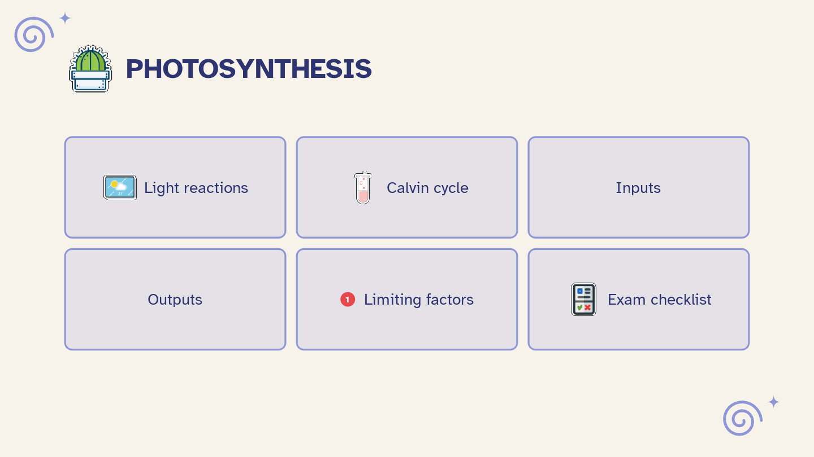

[Manual](../README.md) › [Pitch](README.md) › Present

# Present

Show the slides full screen and move through them with the keyboard or a click.

## Start

Click **Present** (the play button at the top right), or press <kbd>F5</kbd> or <kbd>Ctrl</kbd>+<kbd>Alt</kbd>+<kbd>P</kbd>. It starts from the cover, on the screen where Mentis is.

## Move through the slides

- **Next item or slide**: <kbd>Right</kbd>, <kbd>Down</kbd>, <kbd>Space</kbd>, <kbd>Enter</kbd>, <kbd>Page Down</kbd> or a click
- **Back**: <kbd>Left</kbd>, <kbd>Up</kbd>, <kbd>Backspace</kbd> or <kbd>Page Up</kbd>
- **First / last slide**: <kbd>Home</kbd> / <kbd>End</kbd>

With **One at a time** a list appears item by item; an earlier slide shows complete when you go back.

## End

Press <kbd>Esc</kbd>. The map selects the topic of the last slide shown.

> [!TIP]
> Hidden slides are skipped. If every slide is hidden there is nothing to present: make some visible in the Pitch tab.
