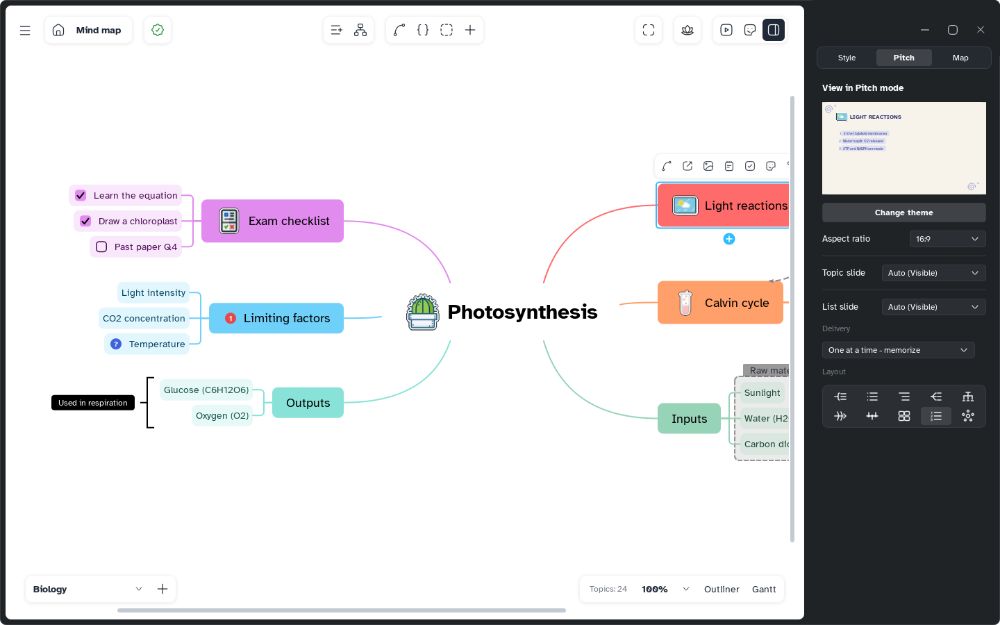
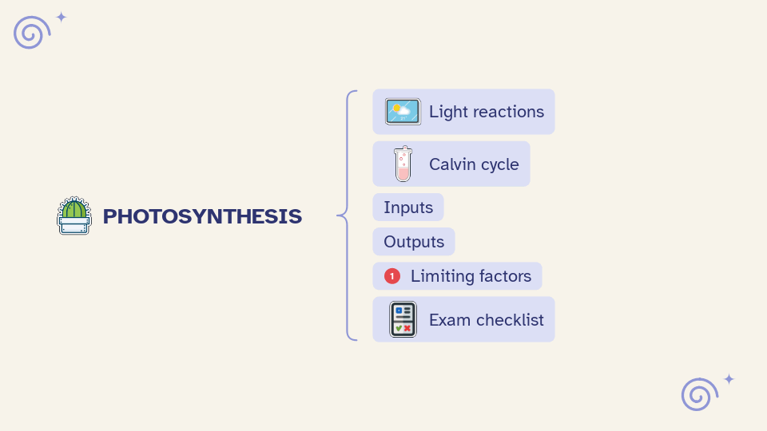

[Manual](../README.md) › [Pitch](README.md) › Slides from the map

# Slides from the map

Mentis makes the slides from the sheet; the Pitch tab decides how each topic is shown.

## Know which slides you get

The map is read branch by branch, in order; floating topics come last. A topic can give:

- a **topic slide**: its title alone, large. The central topic's is the cover; main branches have one too.
- a **list slide**: its title and its subtopics, in a layout. Every topic with subtopics has one.

Topics without subtopics appear in their parent's list, with their picture, sticker, formula and markers. A long list gets smaller text, then goes on in another slide with the same title.

## Change a slide

1. Select a topic and open the side panel on **Pitch**. **View in Pitch mode** shows its slide.
2. Set the options; each change is one step of undo.

| Option | What it does |
|---|---|
| **Aspect ratio** | **Auto** (the screen's), **16:9**, **4:3**, **9:16** or **3:4**, for the whole sheet. |
| **Topic slide**, **List slide** | **Visible** or **Hidden**; **Auto** follows the rules above and says what it gives. |
| **Delivery** | **One at a time - memorize** (earlier items stay, dimmed), **One at a time**, **All together**. |
| **Layout** | Bracket, Bullet list, Aligned right, Fan, Org chart, Fishbone, Timeline, Grid, Numbered list, Circle. |

**Change theme** sets the look of all slides: see [Themes and templates](themes-and-templates.md).
