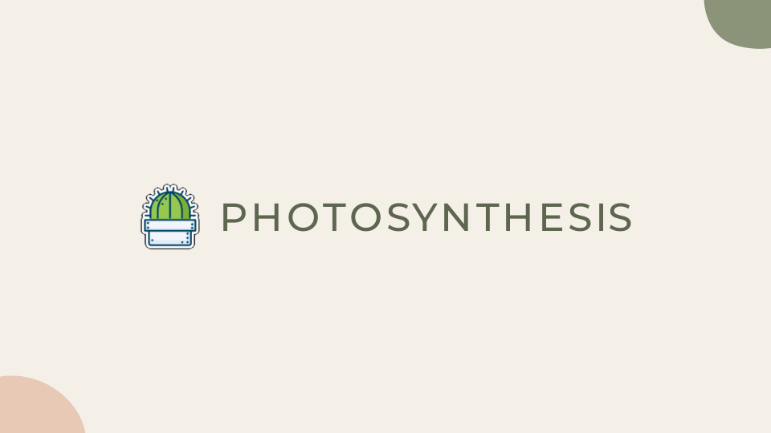
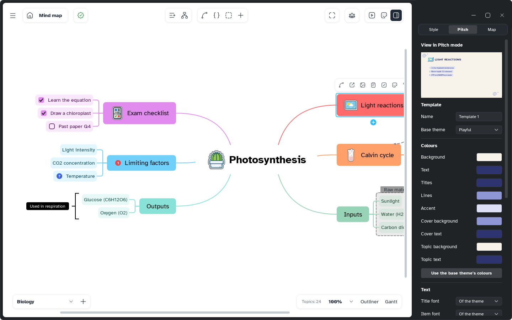

[Manual](../README.md) › [Pitch](README.md) › Themes and templates

# Themes and templates

A theme gives every slide the same look; a template is your own theme, to reuse and share.

## Choose a theme

In the Pitch tab, click **Change theme**. The choice is saved with the sheet.

- **Basic**: Light, Dark, Sheet theme (the map's colours)
- **Illustrated**: Proposal, Paper, Playful, Launch, Night, Manifesto, Halftone, Soft, Portfolio, Editorial
- **Templates**: yours, **New template** and **Import template...**

## Make a template

1. Click **Change theme** › **New template**. The editor opens with a live slide preview.
2. Fill what you need.
3. Click **Save**: the template joins your library and the sheet uses it.

| Section | Fields |
|---|---|
| **Template** | **Name**, **Base theme** (the starting point) |
| **Colours** | Background, Text, Titles, Lines, Accent, Cover and Topic background and text; **Use the base theme's colours** clears them |
| **Text** | **Title font**, **Item font**, **Items** (Text, Pill, Badge, Label), **Motif** (Band, Clouds, Smudge and others) |
| **Pictures** | **Slides**, **Cover and topics**, **Logo**: **Choose...** or **Remove**; pictures cover the whole slide |
| **Logo corner**, **Logo size** | Where the logo goes, how big |
| **Footer** | **Footer text**, **Slide numbers** |

To change it later, choose it and click **Edit template**. **Delete** removes it from your library; maps using it keep their copy.

## Share a template

- **Export...** in the editor saves one `.mentis-theme` file, pictures included.
- **Change theme** › **Import template...** adds one to your library.
- A map keeps a copy of its template. On another computer it shows as *Name (this map)*; **Save** adds it to that library.
