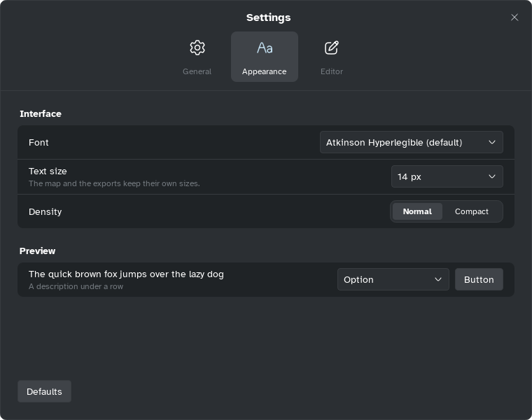

[Manual](../README.md) › [Settings](README.md) › Appearance

# Appearance

Choose the font and size of menus, panels and windows. Maps keep their own fonts and sizes.

## Change the interface

| Option | Choices |
|---|---|
| **Font** | **Atkinson Hyperlegible** (default, easy to read), Atkinson Hyperlegible Next, Arvo, Montserrat, **OpenDyslexic** (for dyslexic readers), Roboto, **System font** |
| **Text size** | 12 to 18 px (14 at first) |
| **Density** | **Normal**, or **Compact** for less space between rows and buttons |

**Preview** shows a row, a select and a button with your choices. **Defaults** goes back to
Atkinson Hyperlegible, 14 px, Normal.

> [!TIP]
> For the map's own font, use **Global font** in [Map style](../style/map-style.md).
