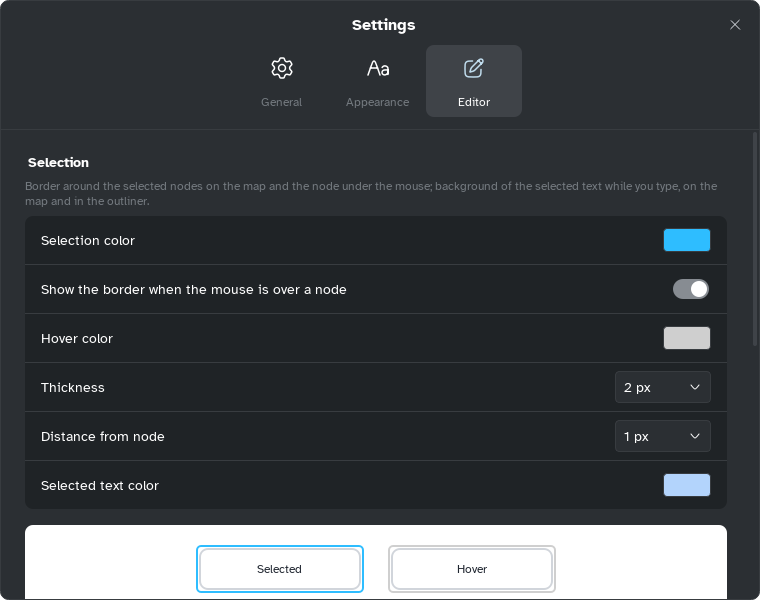

[Manual](../README.md) › [Settings](README.md) › Editor

# Editor

How selection looks, how new maps start, and help while writing.

## Change the selection

| Option | What it does |
|---|---|
| **Selection color** | Border of the selected topics. |
| **Show the border when the mouse is over a node** | A lighter border on the topic under the mouse. |
| **Hover color** | Colour of that border. |
| **Thickness** | 1 to 4 px. |
| **Distance from node** | 0 to 8 px between topic and border. |
| **Selected text color** | Background of selected text while typing, on the map and in the outliner. |

The **Selected** and **Hover** samples show the result.

## Choose the theme of new maps

**Color theme** and **Background**: one of the [color themes](../style/color-themes.md), on white or
one of its six backgrounds. A new sheet takes the theme of the current sheet.

## Set writing help

- **Markdown shortcuts**: on at first, see [Markdown shortcuts](../outliner/markdown-shortcuts.md).
- **Check spelling**: Windows only, off at first, see [Spell check](spell-check.md).

**Defaults** restores the selection style, Dawn on white, Markdown shortcuts on, spell check off.
