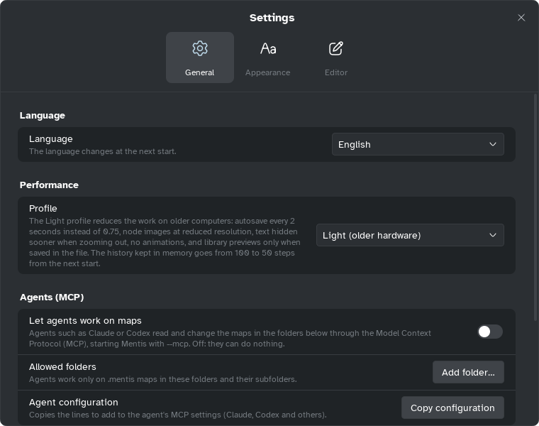

[Manual](../README.md) › [Settings](README.md) › General

# General

Language, performance, the guide, AI agents and updates.

## Language

**Language**: **Automatic** follows the system (the select names it), or pick a language. It
changes at the next start.

## Performance

**Profile**: **Automatic** (**Light** with two processor threads or fewer), **Standard** or
**Light (older hardware)**.

**Light** saves every 2 seconds instead of 0.75, draws pictures at lower resolution, hides text
sooner when zoomed out, has no animations, and shows Home previews only when saved in the file.
From the next start it keeps 50 undo steps in memory instead of 100.

## Guide

- **Show tips**: the first time, the mascot offers the tour of the outliner and of the Gantt, and
  explains the Pitch tab.
- **Restart the tour**: starts the [guided tour](../getting-started/first-map.md#the-guided-tour)
  again.

## Agents (MCP)

**Let agents work on maps**, **Agent apps** and **Agent configuration**: off at first, see
[Set up an agent](../ai-agents/set-up.md).

## Updates

**Check for updates at startup** and **Check now**, with your version: see
[Install Mentis](../getting-started/install.md#updates).

> [!NOTE]
> **Defaults** sets profile and language to **Automatic**, tips on, agents off (folders stay),
> update check on.
