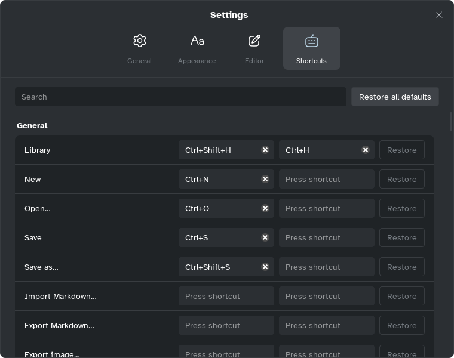

[Manual](../README.md) › [Settings](README.md) › Keyboard shortcuts

# Keyboard shortcuts

The keys you will use most, and how to change any of them.

## Use the main keys

On macOS, <kbd>⌘</kbd> replaces <kbd>Ctrl</kbd> and <kbd>⌥</kbd> replaces <kbd>Alt</kbd>; redo is
<kbd>⌘</kbd>+<kbd>Shift</kbd>+<kbd>Z</kbd>.

| Action | Keys |
|---|---|
| Add child / sibling | <kbd>Tab</kbd> / <kbd>Enter</kbd> |
| Topic before / parent topic | <kbd>Shift</kbd>+<kbd>Enter</kbd> / <kbd>Ctrl</kbd>+<kbd>Enter</kbd> |
| Edit text | <kbd>F2</kbd> or <kbd>Space</kbd> |
| Select a neighbour | Arrow keys |
| Move topic up / down | <kbd>Alt</kbd>+<kbd>Up</kbd> / <kbd>Alt</kbd>+<kbd>Down</kbd> |
| Collapse or expand | <kbd>Ctrl</kbd>+<kbd>/</kbd> |
| Go to central topic | <kbd>Ctrl</kbd>+<kbd>R</kbd> |
| Undo / redo | <kbd>Ctrl</kbd>+<kbd>Z</kbd> / <kbd>Ctrl</kbd>+<kbd>Y</kbd> |
| Save | <kbd>Ctrl</kbd>+<kbd>S</kbd> |
| Find | <kbd>Ctrl</kbd>+<kbd>F</kbd> |
| Map / outliner | <kbd>Ctrl</kbd>+<kbd>Shift</kbd>+<kbd>M</kbd> |
| Gantt chart | <kbd>Ctrl</kbd>+<kbd>Alt</kbd>+<kbd>G</kbd> |
| Previous / next sheet | <kbd>Ctrl</kbd>+<kbd>Shift</kbd>+<kbd>[</kbd> / <kbd>]</kbd> |
| Format panel: Style | <kbd>Ctrl</kbd>+<kbd>]</kbd> |
| Copy / paste style | <kbd>Ctrl</kbd>+<kbd>Alt</kbd>+<kbd>C</kbd> / <kbd>V</kbd> |
| Note / label / checkbox | <kbd>Ctrl</kbd>+<kbd>Shift</kbd>+<kbd>N</kbd> / <kbd>Ctrl</kbd>+<kbd>Shift</kbd>+<kbd>L</kbd> / <kbd>Ctrl</kbd>+<kbd>Alt</kbd>+<kbd>T</kbd> |
| Web link | <kbd>Ctrl</kbd>+<kbd>K</kbd> |
| Auto layout / fit to window | <kbd>Ctrl</kbd>+<kbd>L</kbd> / <kbd>Ctrl</kbd>+<kbd>0</kbd> |
| Present | <kbd>F5</kbd> |
| Focus mode | <kbd>Ctrl</kbd>+<kbd>Alt</kbd>+<kbd>F</kbd> |
| Settings | <kbd>Ctrl</kbd>+<kbd>,</kbd> |
| User manual, on the current page | <kbd>F1</kbd> |

Menus, and a topic's right-click menu, show each command's key.

## Change a shortcut

1. Open **Settings** › **Shortcuts**, or **Main menu** › **Help** › **Shortcuts…**.
2. Find the command in **General**, **Map**, **Outliner** or **Gantt**, or type its name or key
   (`Ctrl+L`) in **Search**.
3. Click one of its two fields and press the new keys; the clear button removes a key.

**Restore** resets one command, **Restore all defaults** every command. If the keys are taken,
**Shortcut already in use** names the command: **Replace** moves them.
