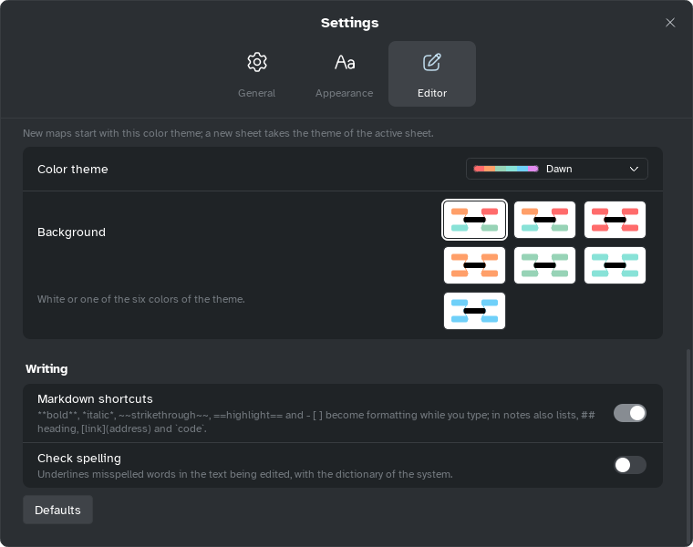

[Manual](../README.md) › [Settings](README.md) › Spell check

# Spell check

On Windows, Mentis underlines misspelled words in the title you type, with the system dictionary.

## Turn it on

1. Open **Settings** › **Editor**.
2. Under **Writing**, switch on **Check spelling** (off at first).

The language is that of Windows' dictionaries.

> [!NOTE]
> Spell check is available on Windows only, for now.

## Correct a word

Right-click a word underlined in red:

| Item | What it does |
|---|---|
| A suggestion | Replaces the word (up to five; **No suggestions** if none). |
| **Learn spelling** | Adds it to your Windows personal dictionary. |
| **Ignore** | Stops underlining it. |

Formulas between `$` signs are not checked.
