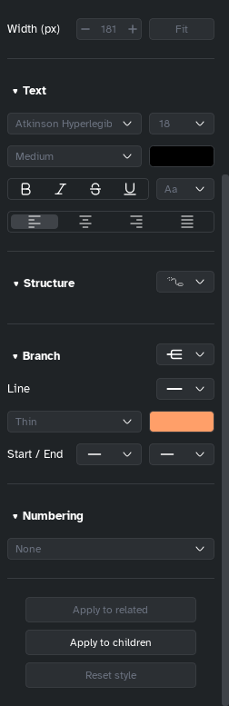

[Manual](../README.md) › [Style](README.md) › Branch lines

# Branch lines

Set the shape, style, width, colour and ends of the lines from a topic to its subtopics.

## Change the lines of a branch

1. Select the topic where the lines start.
2. In the side panel, **Style** tab, go to **Branch**.

| Option | Choices |
|---|---|
| **Shape** (select beside the title) | Rounded bracket, Bracket, Straight lines, Curves, S-curves, Angled lines, Rounded angled lines |
| **Line** | Solid line, Hand-drawn solid, Dashed line, Hand-drawn dashed, Dotted, None |
| **Width** and **colour** | Extra thin, Thin, Medium, Bold, Extra bold; any colour |
| **Start / End** | None, Open arrow, Filled arrow, Dot, Square, Diamond |

A colour or line style reaches the whole branch, except topics that have their own.

> [!TIP]
> For the whole map at once, use **Branch line width** and **Colored branch** in [Map style](map-style.md).
