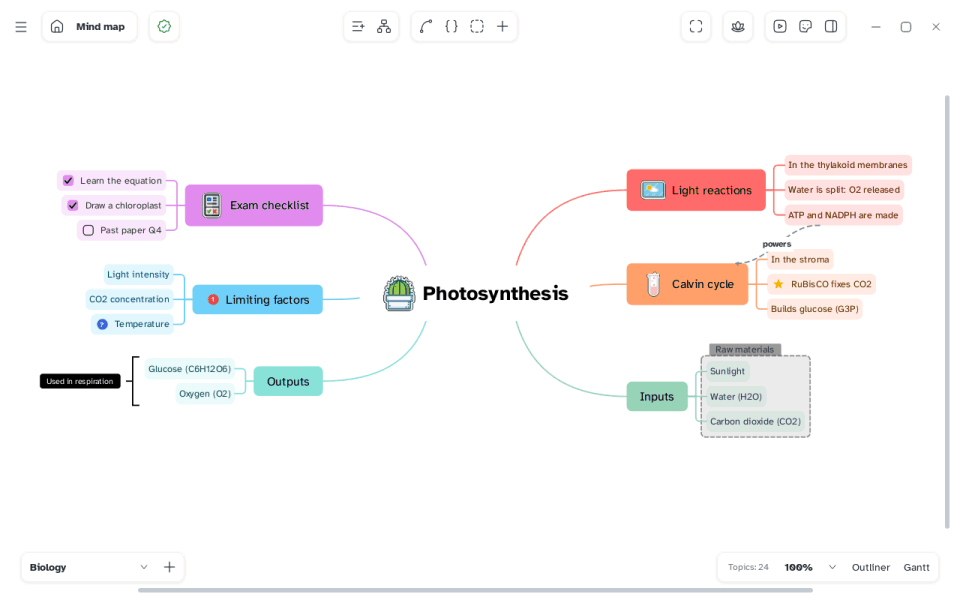

[Manual](../README.md) › [Style](README.md) › Color themes

# Color themes

A color theme colours the whole map: each main branch gets a colour, lower levels lighter shades.

## Choose a theme

1. Click an empty spot of the map, so nothing is selected.
2. In the side panel, open the **Map** tab.
3. Pick a theme under **Color theme**, sorted in **Favorites**, **Colorful**, **Classic** and **Custom**. Click a theme's star to add it to **Favorites**.
4. Choose one of the six pictures below: the same colours on backgrounds from light to dark.

> [!NOTE]
> A theme colours only topics with no colour chosen by hand.

## Create your own palette

1. Click **+** next to the theme select (**Create new color theme**).
2. Choose six colours and a name. **Preview** shows the three levels of each colour.
3. Click **Save**. The palette appears in **Custom**, for every map.

To remove it, right-click it in **Custom** › **Remove**. Maps that use it keep their colours.

## Add a palette from another map

A map made elsewhere keeps its palette, shown as *(not installed)*. Choose **Add "name" to my palettes** in the list.
