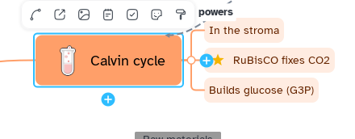

[Manual](../README.md) › [Style](README.md) › Copy and reset styles

# Copy and reset styles

Give one topic's look to others, or bring topics back to their theme's colours.

## Paint a style

1. Select the topic whose style you like.
2. Click the brush, the last button of the bar above the topic (**Format painter**).
3. Click the topics to restyle, or drag a rectangle from an empty spot over many.

One click paints one topic; a double click keeps the brush on until <kbd>Esc</kbd>, another click on the brush, or a click on the empty map.

## Copy and paste a style

- **Copy style**: <kbd>Ctrl</kbd>+<kbd>Alt</kbd>+<kbd>C</kbd> on one topic.
- **Paste style**: <kbd>Ctrl</kbd>+<kbd>Alt</kbd>+<kbd>V</kbd> on one or more topics.

Or: **Main menu** › **Edit**, or right-click. The style works on other sheets and maps until Mentis closes.

| Copied | Not copied |
|---|---|
| Quick style, shape, fill, border, text, branch lines and their colour, numbering | Title, width, structure, notes, links, labels, markers, tasks, relationships, boundaries, images |

> [!NOTE]
> A pasted style counts as chosen by hand: those topics stop following theme changes until you reset them.

## Reset a style

**Reset style** (<kbd>Ctrl</kbd>+<kbd>Alt</kbd>+<kbd>0</kbd>), at the bottom of the Style page, in **Main menu** › **Edit** or on right-click, gives the topics their level's theme look. **Reset map style** in [Map style](map-style.md) does it for the whole sheet.
