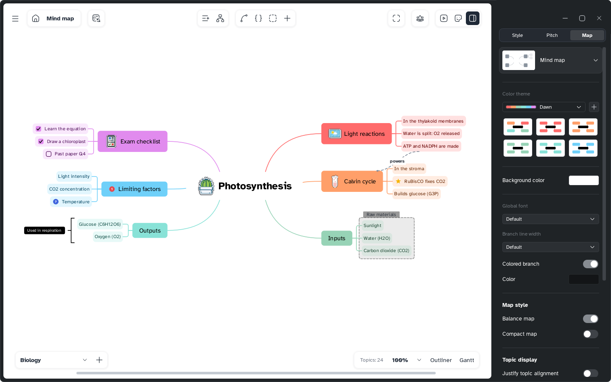

[Manual](../README.md) › [Style](README.md) › Map style

# Map style

Set the background, font, lines and layout of a whole sheet.

## Change the map style

1. Click an empty spot of the map, so nothing is selected.
2. In the side panel, open the **Map** tab.
3. Change an option: it is saved with the sheet, and undoable.

| Option | What it does |
|---|---|
| **Background color** | Any colour behind the map; branches keep theme colours. |
| **Global font** | One font for all topics; a topic's own font wins. |
| **Branch line width** | Every line's width, or *Tapered*: thick to thin. |
| **Colored branch** | On: branches in theme colours. Off: all lines take **Color**. |
| **Balance map** | Spreads main branches evenly on both sides. |
| **Compact map** | Puts topics closer together. |
| **Justify topic alignment** | Topics of a level get the same width. |
| **Show all notes** | Shows every note on the map. |
| **Numbering** | Numbers the whole map ([Numbering](../map/numbering.md)). |
| **Free branch positions** | Branches stay where dropped. |

The card at the top sets the [map type](../map/map-types.md).

## Reset the map style

**Reset map style**, at the bottom, clears the styles of this sheet's topics, relationships and boundaries, and its background and lines. It keeps the theme's background, **Show all notes**, **Compact map**, **Free branch positions** and **Justify topic alignment**.
