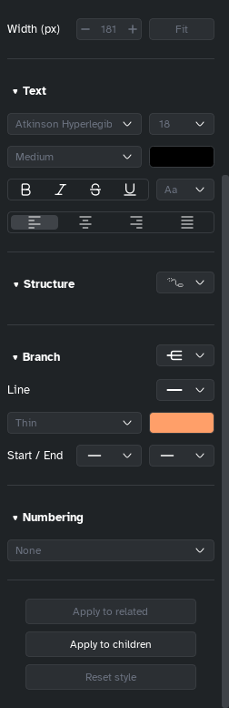

[Manual](../README.md) › [Style](README.md) › Text

# Text

Set the font, size, weight, colour and alignment of the selected topics' titles.

## Change the text

1. Select the topics.
2. In the side panel, **Style** tab, go to **Text**.
3. Change an option.

| Option | What it does |
|---|---|
| **Font** | The family. Atkinson Hyperlegible, the first, is made to be easy to read. *(not installed)* marks a missing font. |
| **Size** | Choose or type a size. <kbd>Ctrl</kbd>+<kbd>Shift</kbd>+<kbd>.</kbd> larger, <kbd>Ctrl</kbd>+<kbd>Shift</kbd>+<kbd>,</kbd> smaller. |
| **Weight** | Thin to Black, as the font has them. |
| **Colour** | The text colour. |
| **Bold**, **Italic**, **Strikethrough**, **Underline** | On or off; underline also <kbd>Ctrl</kbd>+<kbd>U</kbd>. |
| **Letter case** (**Aa**) | **No change**, **All uppercase**, **All lowercase**, on the map only; the typed title stays. |
| **Alignment** | **Align left**, **Center**, **Align right**, **Justify**. |

> [!TIP]
> To format some words only, select them while editing the title: a small bar offers bold, italic and more.
