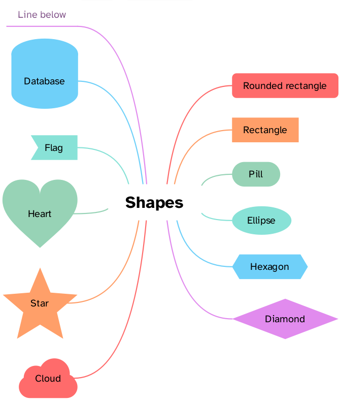
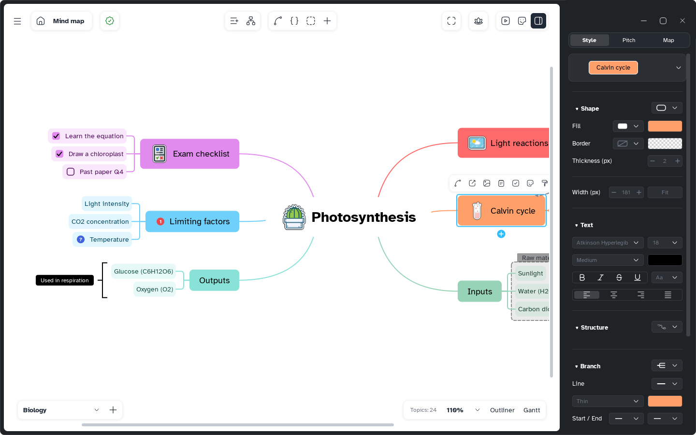

[Manual](../README.md) › [Style](README.md) › Topic style

# Topic style

Give topics their own shape, colours and width, or mark them important in one click.

## Open the Style page

1. Select one or more topics.
2. Press <kbd>Ctrl</kbd>+<kbd>]</kbd>, or open the side panel and choose **Style**.

Each change applies to all selected topics as one undo step.

## Apply a quick style

Pick from the select at the top: **Very important** (<kbd>Shift</kbd>+<kbd>Alt</kbd>+<kbd>1</kbd>), **Important** (<kbd>Shift</kbd>+<kbd>Alt</kbd>+<kbd>2</kbd>), **Strike out** (<kbd>Shift</kbd>+<kbd>Alt</kbd>+<kbd>3</kbd>) or **Default**.

## Change shape, fill and border

| Option | Choices |
|---|---|
| **Shape** (select beside the title) | Basic (rectangles, circle, ellipse, diamond, pill, hexagons, octagon, lines below), advanced (heart, cloud, star, gem, shield, arrows, flag, cards and more), punctuation (brackets, quotation marks), flowchart symbols |
| **Fill** | Filled, Hand-drawn fill, Diagonal strokes, Diagonal hatching, Horizontal strokes, Horizontal hatching, No fill; a colour |
| **Border** | Solid, Hand-drawn solid, Dashed, Hand-drawn dashed, No border; a colour |
| **Thickness (px)** | 1 to 6 px |

## Set the width

Type **Width (px)**; **Fit** restores the automatic width. Or drag the topic's right edge; double-click it to fit.

## Style several topics

- A dash (**—**) means the topics differ; a dimmed value comes **From the palette**, full colour is **Set manually**.
- **Apply to related** styles the siblings; **Apply to children** all subtopics.
