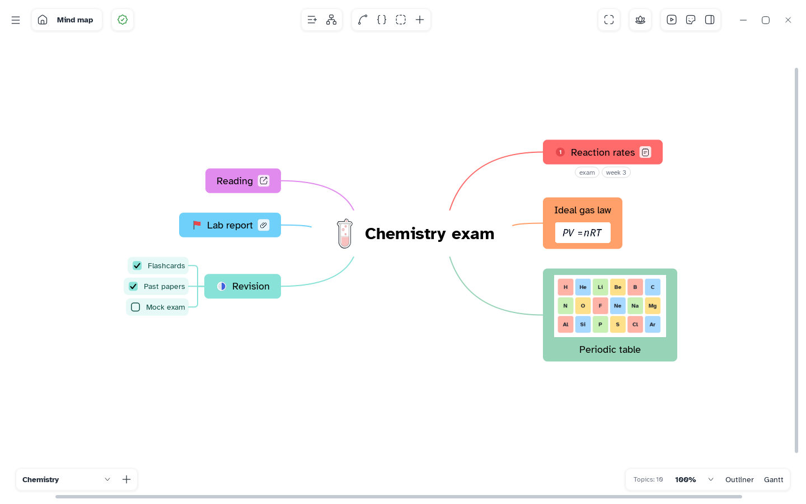

[Manual](../README.md) › Topic contents

# Topic contents

A topic holds more than its title; add it all from **Insert content** (**+** in the top bar), right-click › **Insert**, or the bar above a selected topic.

1. **[Notes](notes.md)** — longer text, with formatting
2. **[Labels](labels.md)** — short tags to group topics
3. **[Checkboxes](checkboxes.md)** — tasks to tick off
4. **[Images](images.md)** — a picture inside the topic
5. **[Formulas](formulas.md)** — LaTeX equations
6. **[Links](links.md)** — to another topic or a web page
7. **[Files](files.md)** — documents kept inside the map
8. **[Markers](markers.md)** — priority, progress, flags and symbols
9. **[Stickers](stickers.md)** — pictures from the sticker library
10. **[The sticker editor](sticker-editor.md)** — change a sticker or draw your own
